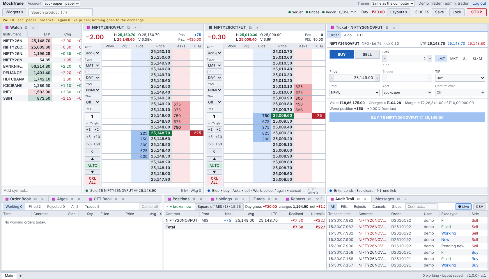
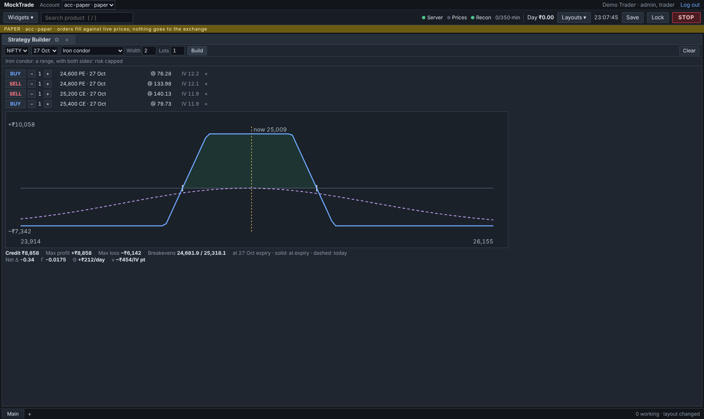
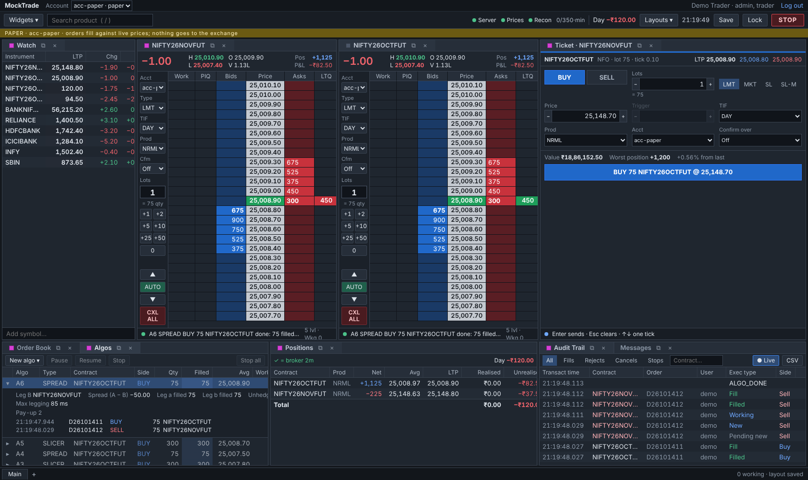
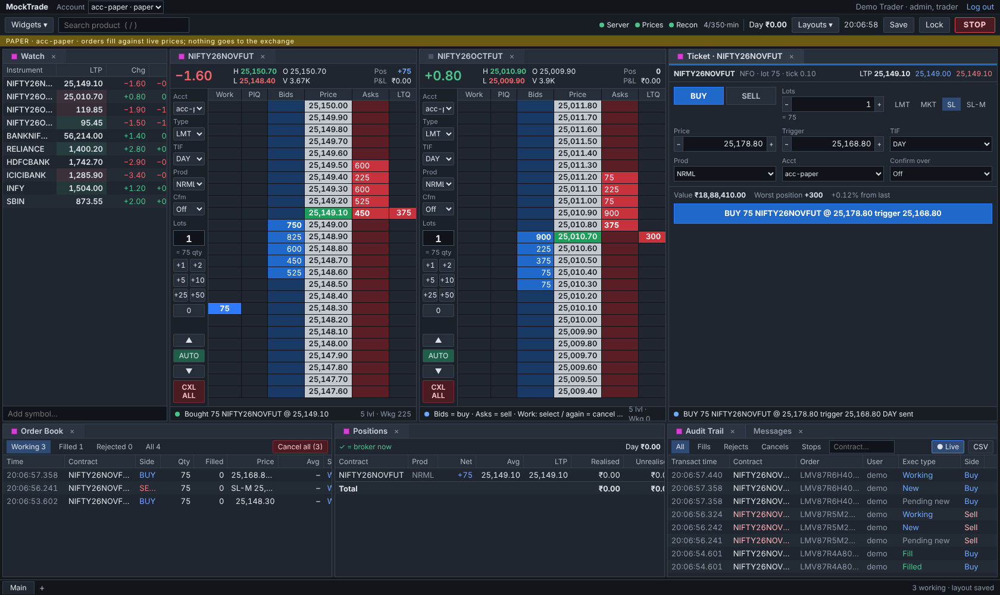

<div align="center">

# MockTrade

**A professional trading terminal and order-management platform for Indian markets (NSE, BSE, F&O)**
Live market data, a price ladder, algos, options, risk controls, and a paper broker that fills
against live prices. Built on Zerodha Kite Connect, behind a broker-agnostic core.

[](https://github.com/ayushsharma05/MockTrade/actions/workflows/ci.yml)


<picture>
  <source media="(prefers-color-scheme: dark)" srcset="docs/images/hero-dark.png">
  
</picture>

<sub>The terminal running on the demo: a watchlist, two live depth ladders, an order ticket with margin and charges,
the order book, positions with P&L, and the audit trail, all streaming in real time.</sub>

</div>

---

## What it is

MockTrade is a full trading stack for a trading desk, or for several firms on one server:
- **A Python server** that holds the order manager, the risk engine, positions and P&L, an algo
  engine, and an append-only audit log.
- **A React terminal** of dockable widgets that stream from it.

It trades through **Zerodha Kite Connect** (REST for orders, WebSocket for ticks) or a
**paper broker** that simulates fills, queue position and latency against live prices. Every
external dependency (broker, market data, charges, storage) sits behind a small interface, so
each can be replaced without touching the core.

Its design rule is **"the backend provides, the frontend displays"**. The server publishes what
is allowed for each instrument: order types, lot and tick sizes, cut-off times, and why an order
was refused. The UI hard-codes no market rules.

## Highlights

| | |
| --- | --- |
| **Trading terminal** | Dockable widgets (dockview) with linked colour groups and pop-out windows (Electron): a depth ladder with volume at price, an order ticket, a watchlist, charts, time and sales, market movers, and light, dark and colour-blind-safe themes. |
| **Order management** | A full order lifecycle with modify and cancel, partial fills, baskets, GTT triggers, and reconciliation against the broker's own book. |
| **Risk engine** | Pre-trade checks (size, value, position, price bands, lot and tick, daily loss, open orders, double-click), margin, an 8-orders-per-second sliding-window throttle, firm- and account-level kill switches, and reduce-only exits. |
| **Algos** | A parent/child algo engine: slicer, iceberg, TWAP/VWAP, POV, a two-leg spreader, and protection algos (trailing stop, OCO, bracket). |
| **Options** | An option chain with Greeks, a multi-leg strategy builder with payoff charts, and basket orders. |
| **Research** | Tick recording, replay of a recorded day as if live, and backtests that run the same engine, paper broker and risk checks. |
| **Operations** | Crash recovery from the audit log, backups with checksums and verified restore, deploys gated to market hours with automatic rollback, operational alert bands and webhooks, a status page of every part, JSON logs with request and order ids, and a Grafana dashboard. |
| **Security and firms** | Password + authenticator login, step-up for privileged changes, key rotation, a hash-chained audit trail, logs without secrets, signed dependencies; several firms on one server, each seeing only its own users, accounts and its own traders' Zerodha prices. |

## Screens

| Order book, positions, audit trail | Option chain with Greeks |
| --- | --- |
|  |  |
| **Strategy builder (payoff)** | **Algo manager** |
|  |  |
| **Order ticket** | **Kill switch: a report of exactly what STOP did, then Flatten** |
|  |  |

## Architecture


```
 Kite WebSocket ─► decoder ─► MarketData ─┬─► paper broker (fills)  ─┐
                                          ├─► algos, MTM limits       │
                                          └─► stream ─► React UI      │
 React UI ─REST─► API ─► OrderManager ─► gates: risk → margin → throttle ─► broker (Kite | paper)
                              │                                             │
                              ◄──────────── order updates / fills ──────────┘
                              └─► positions & P&L · charges · audit log (SQLite) · stream
```

- **The order manager** owns every order's lifecycle. It never re-sends an order whose fate is
  unknown: an unanswered order stays UNCONFIRMED until the broker's own order list settles it.
- **The risk gates** turn every refusal into a plain-English reason that the screens show
  verbatim.
- **Crash safety:** state is rebuilt from the audit log and the broker on start, and trading
  stays shut until positions reconcile.
- **Safe exits:** every forced close goes through one "exit desk". It stops the algos on that
  position, cancels resting closing orders, and sends only reduce-only orders, so overlapping
  exits can never reverse a position.

More: [architecture](docs/design/kite-architecture.md) · [domain model](docs/design/domain-model.md) ·
[order life](docs/design/order-life.md) · [all design docs](docs/design/README.md)

## Engineering

| | |
| --- | --- |
| **Size** | ~30k lines of Python and ~18k lines of TypeScript (plus ~3k of CSS), and ~35k lines of tests |
| **Tests** | 1,600+ server tests (pytest) and 530 screen and desktop tests (vitest), plus type checks, run in CI on every pull request with a dependency audit, secret scanning and SBOMs |
| **Mutation testing** | 80+ scripts that inject deliberate bugs into the rules and check that a test catches each one |
| **Real-browser checks** | 40+ Playwright scripts against the live demo, with screenshots kept as evidence |
| **Drills** | Crash-and-restart, backup-and-restore, a stolen credential and deploy-and-rollback, each rehearsed for real |
| **Process** | Every change goes issue → branch → pull request (`Closes #N`) → green CI → merge ([CONTRIBUTING.md](CONTRIBUTING.md)) |

## Quick start (demo: no broker account needed)

```bash
make setup     # once: the server, its test tools and the screens (in a virtual environment)
make demo      # http://localhost:8000, user demo / demo-password-123
make code      # the login code, in a second terminal
make check     # everything CI checks
```

Everything else (the tests, the desktop app, Docker, live Kite prices) is in
**[docs/running-locally.md](docs/running-locally.md)**.

## Documentation

- **[docs/README.md](docs/README.md):** where everything is. **[CONTRIBUTING.md](CONTRIBUTING.md):** how a change is made.
- **[The guide](docs/guide/README.md):** the whole system from first principles, with diagrams, in ten chapters.
- **[Reading order](docs/guide/reading-order.md):** every source file, in the order to read it.
- **[Design docs](docs/design/README.md)** · **[Runbooks](docs/runbooks/README.md)** (morning routine, incidents, release, go-live, several firms) · **[Roadmap](docs/roadmap/README.md)** · **[Changelog](CHANGELOG.md)**

## How it was built

MockTrade is my project. I defined the product, the requirements and the safety rules (Kite's
limits and SEBI's rules for algorithmic trading), set the priorities, and reviewed and accepted
each milestone. The implementation was written with AI pair-programming (Claude Code),
working issue by issue under that direction. The design notes, decision log and every pull
request are in the repo.

## Status

- **Version:** `1.0.0-rc.1`, plus the hardening since (see the [changelog](CHANGELOG.md)).
- **Paper trading:** complete. The code is production-grade.
- **Live trading:** only after the manual go-live checklist
  ([docs/runbooks/go-live.md](docs/runbooks/go-live.md)) and an independent security review.
- **Next:** the feature issues on GitHub ([roadmap](docs/roadmap/README.md)).

<sub>Not affiliated with Zerodha. Market rules (lot sizes, cut-off times, SEBI requirements) change, so re-check them before trading real money.</sub>
