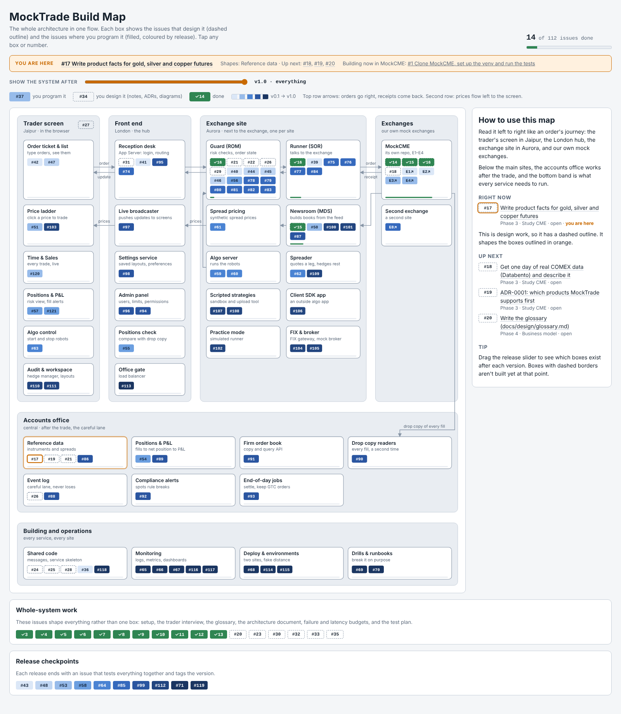
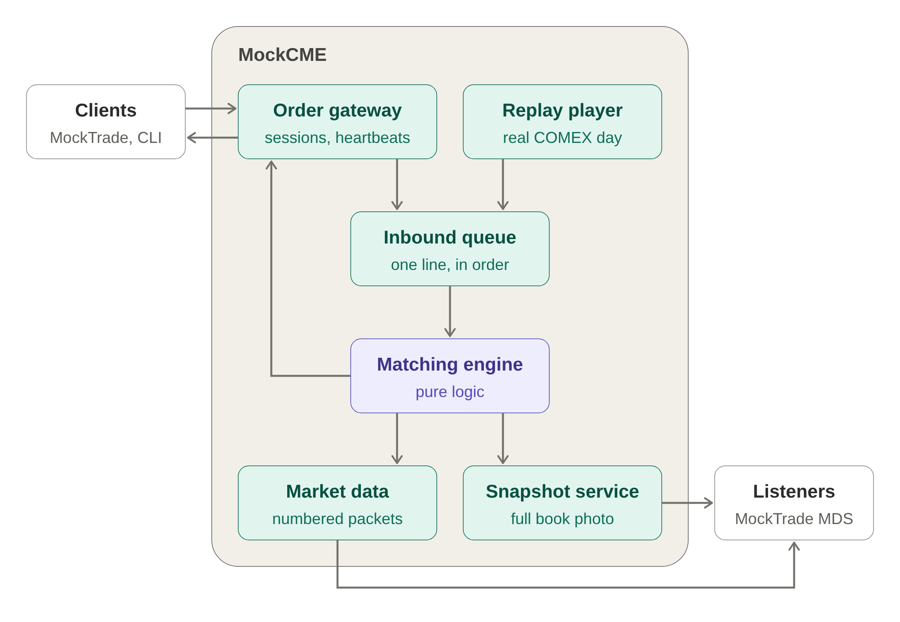
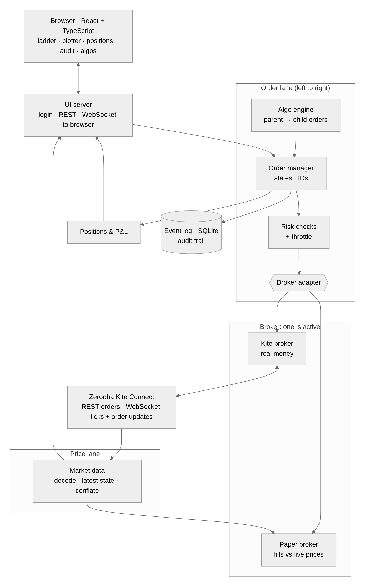

# Conversation log: how MockTrade and MockCME came to be

A summary of the first long planning conversation (5–12 Oct 2026), in order. It replaces the raw chat, which can't be committed because it contains the firm's internal details.

## 1. Understanding a professional trading platform (private)
- Ayush wanted to understand the trading platform his firm uses: its architecture, latency and how orders travel. He shared drawings and a few config and UI files.
- Claude explained it in very simple language with flowcharts and produced three private reference files: **NG One Chart**, **NG Architecture** and **How NG Works**. They stay private, outside the repos.
- Key ideas he took away, which MockTrade copies in generic form:
  - Robots and the risk guard sit **next to the exchange** (co-location), because Jaipur → Chicago is about 85 ms one way, slower than any robot.
  - A central **hub** handles screens and logins. Screens never talk to the exchange directly.
  - There's a **fast lane** for orders and prices, and a **careful lane** for fills, positions, P&L and audit.
  - Every order passes a **guard** (risk checks) and then a **runner**, which speaks the exchange's language.

## 2. Deciding to build his own: MockTrade
- He decided to design and build his own platform from scratch as a learning project. He named it **MockTrade** (not NG) and runs it against a mock exchange replaying real data.
- Goal: a real, complete project he understands bit by bit, with the whole one-chart architecture built in mock form.
- He asked Claude to act as the expert team and to put the whole plan into **GitHub issues**, so he can go step by step.

## 3. Repo and backlog (MockTrade)
- Repo `ayushsharma05/MockTrade` (private). Copilot made the folder structure, and Claude added CI (`pytest` on PRs).
- Claude created labels, 18 milestones (Phase 0–8 design, then releases v0.1–v1.0) and issues #3–#121. #119 tracks that every box of the reference architecture gets built.
- Ayush finished the Phase 0 setup on his Windows laptop (Git, Python, VS Code, his first PR).
- Phase 1 (the trader): user stories and a trader interview (he is the trader). He felt discovery was taking too long, so it was compressed into a one-page **product brief** (`docs/requirements/brief.md`, PR #122): scope GC/SI/HG, multi-leg structures, GTC orders, hard latency numbers and 15 core stories.

## 4. Studying CME (Phase 3)
- #14: a paper exercise on how matching works (sells 2400.4 × 3 and 2400.5 × 5, then buy 6 @ 2400.5).
- He asked why study CME's MDP at all, since MockTrade isn't tied to one exchange. Answer: the **adapter pattern**. Generic ideas go in the core, CME-specific names and numbers go only in the adapter. CME's specs are excellent and public, and his data is in CME format.
- He asked what to read on the CME Client Systems wiki. The pages load with JavaScript and couldn't be fetched, so Claude wrote a beginner guide from CME's public specs: [cme-wiki-guide.md](cme-wiki-guide.md), with 3 diagrams.
- He closed #14, #15 and #16.

## 5. The build map
- He asked to see which issue programs which part of the architecture, so he always knows where he is.
- Claude built the **MockTrade Build Map**, an interactive page: every box of the architecture with the issues that design it (dashed) and build it (coloured by release), a "you are here" marker and a release slider. Files are in [build-map/](build-map/); screenshot below.

## 6. The exchange gets its own repo: MockCME
- He suggested building the mock exchange first, in its own repo, because a real exchange exists before the platforms that connect to it.
- Agreed, with one change: write the **spec in full**, then **build in releases** (E0–E8), rather than "complete" all at once.
- Ayush created `ayushsharma05/MockCME`. Claude pushed the skeleton (package folders, smoke test, CI, PR template), created 9 milestones and 40 issues written code-first (goal → steps with file and function names → tests to write first), and opened design **PR #41** (`docs/design.md`).
- The 6 exchange issues in MockTrade (#34, #37, #38, #49, #52, #73) were closed as moved, with links. #39, #50, #55, #76 and #77 got cross-links. The build map now points to MockCME's milestones.

## 7. Mid-conversation questions worth remembering
- **"Are we writing our own TCP and UDP?"** No. The operating system provides TCP and UDP through sockets. We write the protocols on top: iLink-lite for orders (logon, sequence numbers, heartbeats, resend) and MDP-lite for prices (numbered packets, gaps, snapshots). E3 builds reliability on top of UDP, the same core idea TCP uses. A "write a tiny TCP yourself" side-quest issue was offered for later.
- **"Show the diagram here."** The MockCME architecture above, with its order path explained.

## 9. Change of plan: NSE/BSE on Kite Connect (14 Oct 2026)
- Ayush paused MockCME and asked for MockTrade to connect to the real Indian market through Zerodha Kite Connect, designed like a professional platform team, with a broker adapter (real Kite + paper simulator), honest limits, and a one-small-server deployment ($100 cloud credits, ₹500–800/month budget).
- Claude researched Kite and SEBI rules (sources in the design doc). Key findings: ~1 tick/s per instrument, 5-level depth, 10 orders/s, static IP for order endpoints since April 2026, market_protection mandatory, daily manual login.
- Decisions: one Python asyncio process (modular monolith); official SDK for REST, own asyncio WebSocket client + decoder; SQLite event log; FastAPI; React + TypeScript widgets; AWS Lightsail Mumbai 2 GB ($12/month, static IP included).
- 33 issues created (#124–#156), old issues labelled `paused: cme-track`.
- Mid-way Ayush asked to keep the desktop app and widget forms in mind (like Electron desktop trading apps): the UI became a dockable widget workspace (#145) with an Electron shell later (#156, Tauri as the lighter option to compare).
- He also asked for progress updates as work happens, in case usage limits run out mid-task.

## 10. Multi-user, broker-agnostic, and Claude codes it (14 Oct 2026)
- Ayush asked for MockTrade to be **multi-user** (users registered through their broker's login), following all exchange rules, with Zerodha as only one broker (others or own exchange access later), modelled on the reference platform's professional architecture.
- Research found: a retail Kite app is bound to one client id (multi-user needs a Zerodha arrangement); Kite data can't be shown to other users (needs an authorised data vendor); serving others makes the platform an algo provider (exchange empanelment; broker is principal; algo IDs); black-box algos need SEBI RA registration. Design runs for him + family accounts until those gates are passed.
- Delivered the **MockTrade One Chart** (`context/one-chart/one-chart.html`, PNG in images) and §0 of the design doc.
- He asked Claude to **write the whole project** professionally with extensive tests, sending progress updates; he'll type "continue" when limits reset. K0 (#158) and K1 (#159) done, CI green.
- He asked that the UI be designed as thoughtfully as the backend (as with a chart-trading app he works on); a UI design pass with mockups is planned before UI code.

## 11. K2 paper broker (14 Oct 2026)
- Ayush asked that no part be rushed: "treat every part as one project and brainstorm and focus until it finishes". Claude adopted brainstorm → design → code → extensive tests → self-review → PR + context for every part.
- The self-review before tests found 5 realism bugs (double-counted volume, price improvement for resting orders, qty raise keeping queue place, a stale OPEN after cancel, string-id ordering). Writing the tests found 4 more (no volume baseline on the first tick, trade-through only partly filling, triggered stops filling at their own price, volume from before we joined counting). All fixed.
- Each fill rule was then broken on purpose to prove a test catches it (10/10 caught). PR #160, 167 tests.

## 12. K3 orders and risk (14 Oct 2026)
- After lunch Ayush asked Claude to continue on its own (limits reset at 12:10 his time), "treat every point of this project as a separate project", and make the app "very useful, intuitive, scalable and reliable".
- Claude built K3 as five stacked PRs, each brainstormed first (the real-world failure cases in a table), then code, tests, a mutation check (breaking each rule to prove a test catches it) and self-review:
  - #161 order manager: forward-only states, match by tag then broker id, idempotent submit, UNCONFIRMED on unknown outcomes, cancel before ack.
  - #162 throttle: sliding windows instead of the issue's token bucket (a bucket lets 15 orders out in one second); tests caught algo orders jumping the queue.
  - #163 risk checks and kill switch: 11 checks with trader-readable reasons; closing is always allowed; STOP engages first, then cancels.
  - #164 event log: SQLite writer thread, retries without loss, restart = rebuild + reconcile + continue ids.
  - #165 Kite adapter: which Kite errors mean "not placed" vs "unknown"; order fields checked against the official SDK; reconcile on every reconnect; amo_check tool for the go-live check.
- Diagram: 

## 13. K4 positions and reconciliation (14 Oct 2026)
- Ayush said "continue". Claude built K4 as two stacked PRs, same process (brainstorm table of traps → code → tests → mutation check → PR):
  - #166 positions and P&L: exact fractions for averages like ₹100.075; realised + unrealised checked against the cash-flow formula on random fills; replays never double count; auto kill switch on the daily loss, once per day.
  - #167 reconcile with the broker's positions: alert only after two checks in a row (a fill can be in flight), quick 10 s re-check, never auto-corrects, outside trades flagged.

## 14. K5.1 server and K5.2 stream (14 Oct 2026)
- #168 server: threat table first (passwords, code replay, brute force, cookies, CSRF, impersonation, fake broker callbacks, wrong Zerodha account, leaked DB). Tests found that failed-login counts were rolled back by the database, so the lockout never worked; fixed. A mutation run killed by a timeout left one line mutated; the suite caught it, and the mutation harness now always restores files.
- #169 stream: prices conflated, orders never; slow browsers disconnected rather than silently skipped; contract written in docs/design/stream.md. Tested against a real uvicorn server.
- Next: the UI design pass with mockups for Ayush's approval (promised earlier), before UI code.

## 15. UI design pass: direction changed (14 Oct 2026)
- Claude drew 7 mockups (design system, workspace, ticket states, stopped, login, audit, phone) on a design canvas.
- Ayush: "looks more like an AI designed website, instead it should look like a trading platform"; trading must be very convenient; common professional ladder designs are the reference, never copied. He shared screenshots of his firm's platform for reference only (not saved anywhere, never to be committed).
- Claude rebuilt the ladder as a working, clickable prototype (simulated prices and fills) and the workspace as a dense terminal (5 ladders, market watch, orders, positions, audit trail grids). Remaining boards are marked "old style" until the direction is approved.

## 16. K5.3 skeleton and K5.4 ladder, continued in a cloud session (14 Oct 2026)
- The claude.ai chat ran out of usage right after opening #170 (K5.3). Ayush continued in a Claude Code cloud session (with $100 credit), asking it to read the whole repo and context first and to remember every point from the chat.
- #170's `ui` CI was red: `ui/src/lib/format.ts` had never reached GitHub because the template Python `.gitignore` ignores every `lib/` folder. Rebuilt from its callers and tests (Indian grouping, real minus sign, India-time clock); `.gitignore` now ignores only `/lib/`. CI green. Ayush OK'd pushing straight to the milestone branches (k5-3-ui, k5-4-ladder) as before.
- K5.4 ladder (#171), built to the approved canvas board 0: Work | PIQ | Bids | Price | Asks | LTQ | VAP, sidebar Acct/Type/TIF/Prod/Cfm, lots presets, AUTO centre, CXL ALL. Brainstormed traps first (tick grid, 5 levels only, PIQ after my order shows, lost "place" answer, unconfirmed orders, big mis-clicks, market protection, getting out while stopped, rows jumping). PIQ is estimated in the browser with the paper broker's rule; VAP counted on the server. 13/13 mutations caught; paper trading checked end to end in a real browser.

## 17. K5.5 screens, and keeping context current (14 Oct 2026)
- Ayush said "continue". K5.5 (#172): Order Book, Positions, Audit Trail (with each order's timeline, live catch-up, CSV) and Messages, built to canvas board 2; a new server endpoint pages the account's audit trail. Same process: traps table, tests, 13/13 mutations, real-browser check. The browser check found two things fixed before the PR: fills showed as two identical "Filled" rows (now "Fill" for the trade, "Filled" for the state), and narrow windows squeezed columns (now they scroll sideways).
- Ayush asked that context be updated at every important point, because each chat hits its limit (1M tokens here) and the next chat must continue from "continue" alone. Added a "How to continue" checklist to `context/README.md`, the check scripts in `context/scripts/`, and a continuity section in `working-with-ayush.md`.

## 18. "Complete the whole project" and the product direction (14 Oct 2026)
- Ayush asked to complete the whole project, designed like the platform a top professional trading-software company would build for India, paying only for the Zerodha API. Every component independent and replaceable. Claude acts as the whole expert team.
- He then said: don't copy or mention any other vendor; MockTrade is its own product and may be deployed professionally in India later. All vendor mentions were removed from the repo and context.
- And: "backend provides, frontend displays". The UI must not hard-code order types or other market rules: the server publishes an order spec (types, required fields, validities, products, rules) and the screens render from it. Applied first to the order ticket and ladder (#173).
- Plan agreed: order ticket (#173) → Electron (#156) → K6 algos (#148–#151) → K7 deploy (#152–#155), one stacked PR each, context updated at every PR; then a product-vision catalogue of what a professional Indian-market platform provides, turned into new milestones.

## 19. Order spec, desktop app and speed (14 Oct 2026)
- #175: order ticket for every order type, drawn from the server's **order spec** (Ayush: "frontend displays what the backend provides; another market may have 5 order types"). The spec is enforced by the order manager too. Paper now refuses stops the market already passed, like Kite.
- #176: pop-out widget windows (browser and desktop) that share the main page's live connection, and the Electron desktop app with locked-down pages, measured in a real Electron run.
- Ayush: "ensure syncing and latency are very fast from our side". Pop-outs already add no sync delay; next is the stream (send at once, conflate only bursts) and K7.3 measurements.
