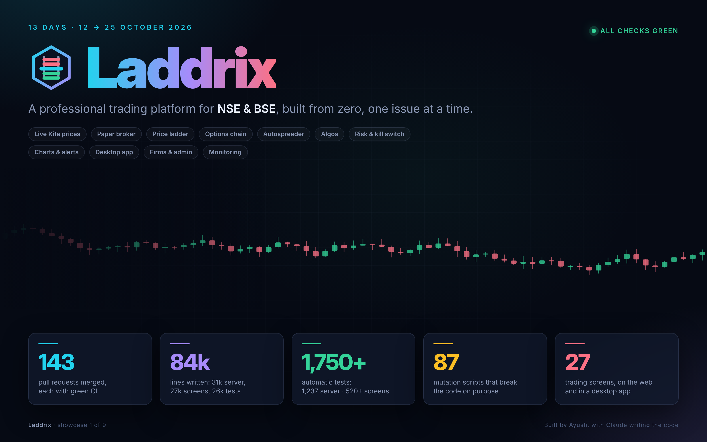
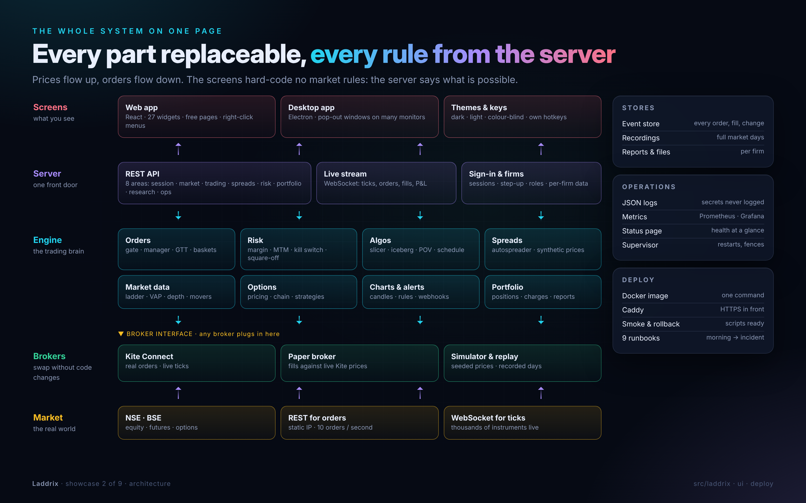
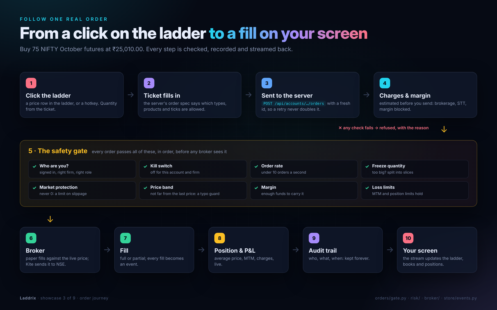
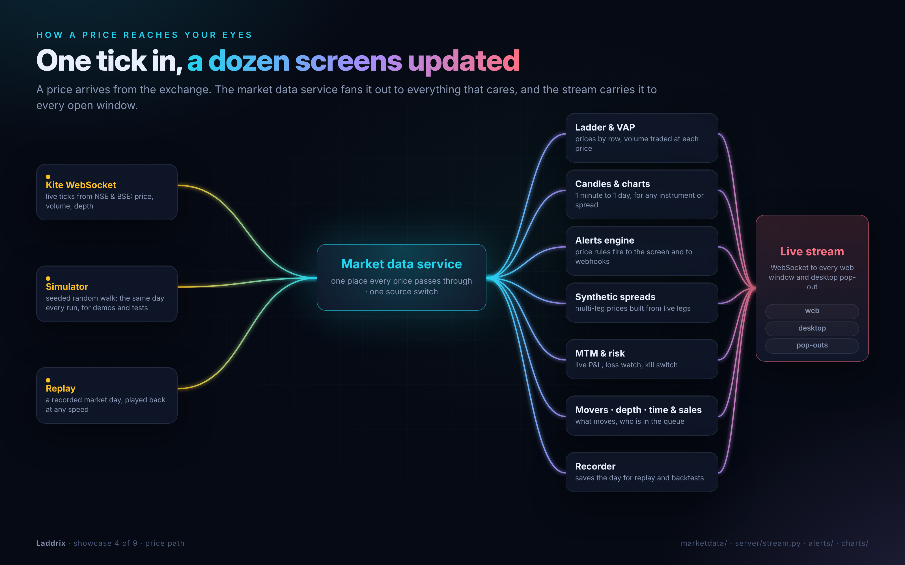
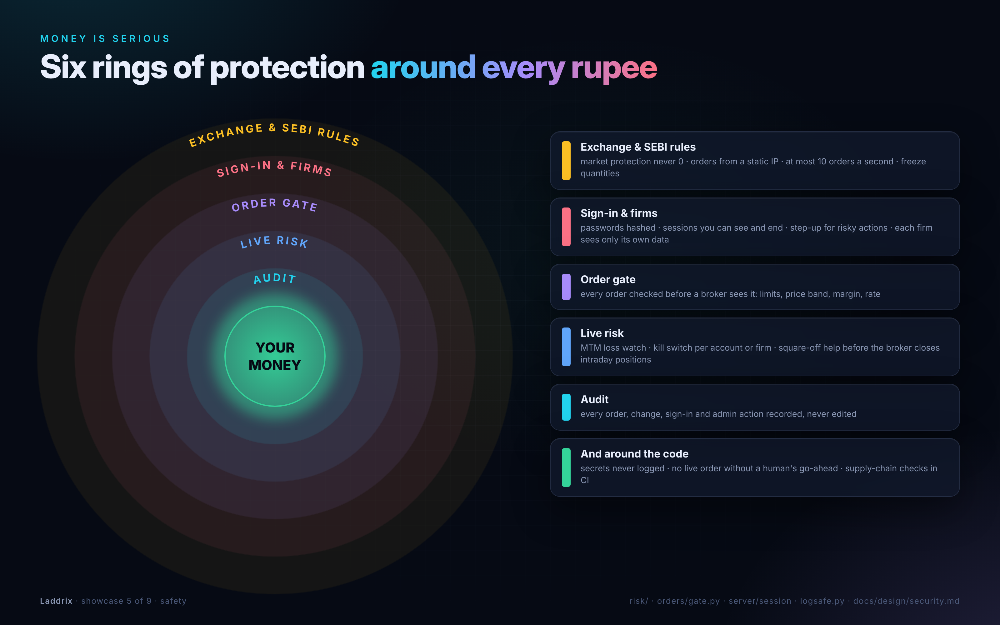
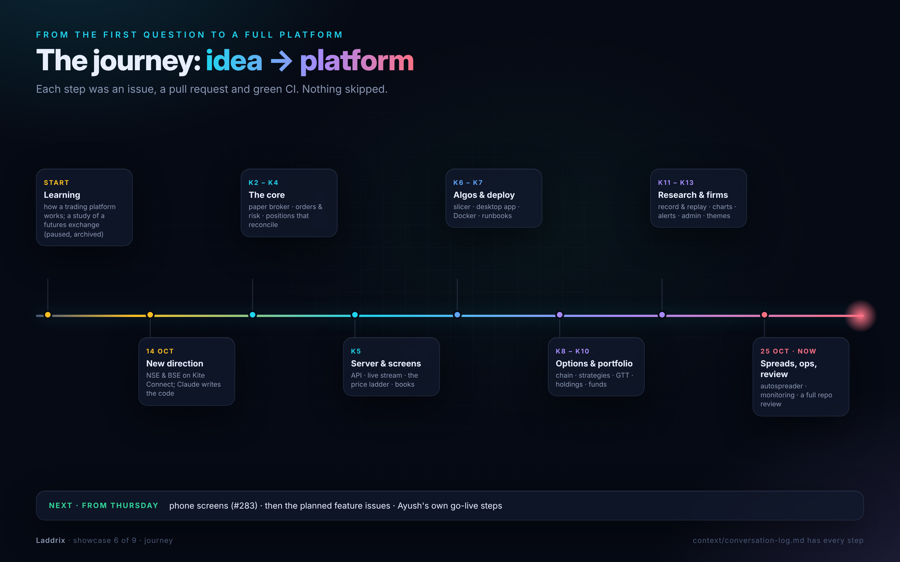
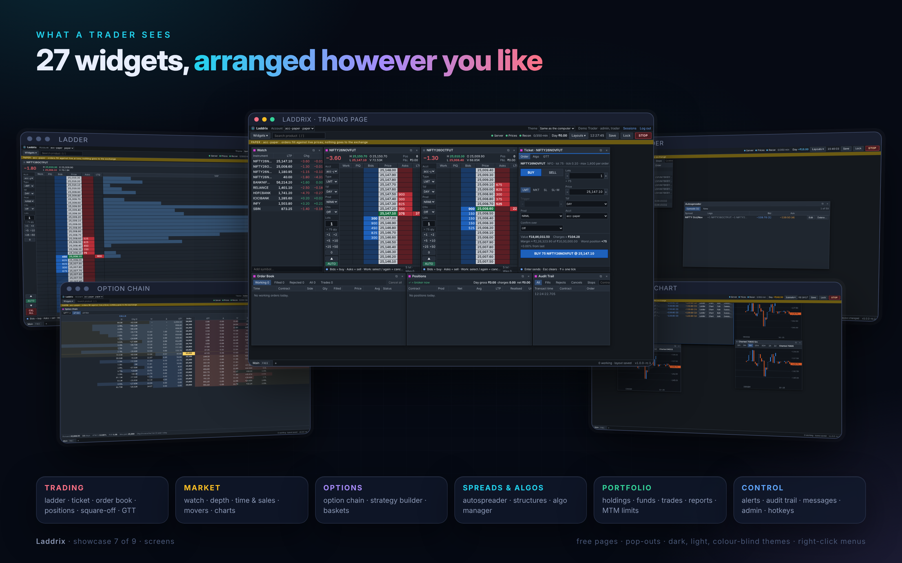
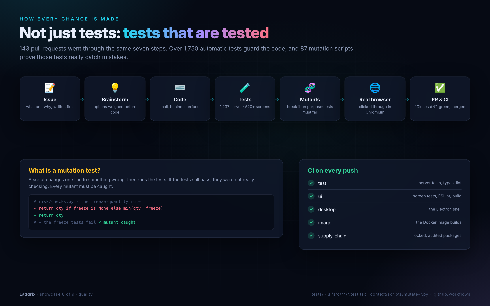
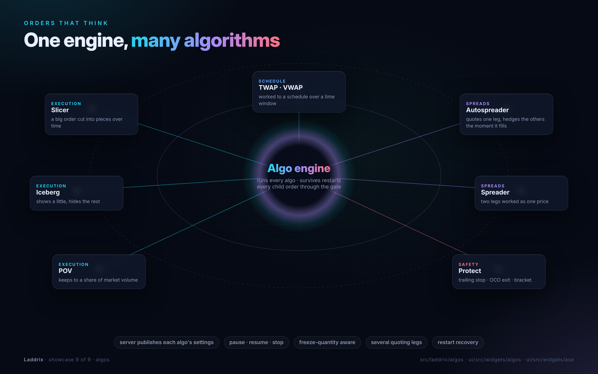

# Showcase: what we built (#455)

Nine posters of Laddrix as it stood on 25 October 2026, after 13 days and 143 merged pull requests. Each one is a page in this folder, and `render.cjs` turns it into a PNG in `context/images/showcase/`.

| # | Picture | What it shows |
|---|---------|---------------|
| 1 |  | **Laddrix in numbers**: 143 PRs, 84k lines, over 1,750 tests, 87 mutation scripts, 27 screens |
| 2 |  | **Architecture**: market, then brokers behind one interface, then the engine, the server and the screens, plus stores, operations and deploy |
| 3 |  | **One order's journey**: a click on the ladder, then the ticket, the safety gate (8 checks), the broker and the fill, then P&L, the audit trail and the screen |
| 4 |  | **The price path**: Kite, the simulator or a replay feeds the market data service, which fans out to the ladder, charts, alerts, spreads, risk and the recorder, then the stream carries it to the screens |
| 5 |  | **Six rings of safety** around the money: exchange rules, sign-in and firms, the order gate, live risk, the audit trail, and the code itself |
| 6 |  | **The journey**: from learning, to the switch to Kite on 14 Oct, through phases K2–K13, to spreads, operations and the review |
| 7 |  | **The screens**: real screenshots (ladder, trading page, option chain, autospreader, spread chart) and the six widget groups |
| 8 |  | **The quality machine**: issue, brainstorm, code, tests, mutants, a real browser, then PR and CI. Also explains what a mutation test is |
| 9 |  | **The algo engine**: slicer, iceberg, POV, TWAP/VWAP, autospreader, spreader and protect |

## Redraw them

```
node context/showcase/render.cjs          # all nine
node context/showcase/render.cjs 03       # only 03-order-journey
```

Each poster is plain HTML that shares `style.css`. To change one, edit its `.html` file and run the command again. The numbers on poster 1 were counted on 25 Oct (lines with `wc -l`, tests by counting `def test_` and `it(`). Re-count them when you refresh it.

## The video

There are two videos, both at 1920×1200 with music:
- [video/laddrix-showcase.mp4](video/laddrix-showcase.mp4) is about a minute long: the nine posters, the journey timeline among them, then the end card (`make_video.py short`).
- [video/laddrix-advert.mp4](video/laddrix-advert.mp4) is an advert of about two and a half minutes at 1920×1200, about the product only. It has five parts:
1. the opening and the logo;
2. the screens;
3. under the hood (camera glides across the posters);
4. running it for a firm;
5. the finale.

The music is computed from sine waves and noise (a pad, then bass, a beat and an arpeggio, a whoosh on each cut), so there is nothing to license.

The app screenshots it uses are in `context/images/showcase/screens/`:
- `context/scripts/shoot-showcase.cjs` takes most of them from a running demo, in dark mode.
- `autospreader`, `spread-chart`, `structures` and `algos` are older shots that have live spreads and algos, with their top menu bar trimmed off: a fresh demo has none of those to show.

To rebuild everything:

```
python3 -m laddrix.tools.demo --port 8000 --ui ui/dist &    # then wait for it to be ready
node context/scripts/shoot-showcase.cjs
node context/showcase/render.cjs && python3 context/showcase/video/make_video.py && python3 context/showcase/video/make_video.py short
```
