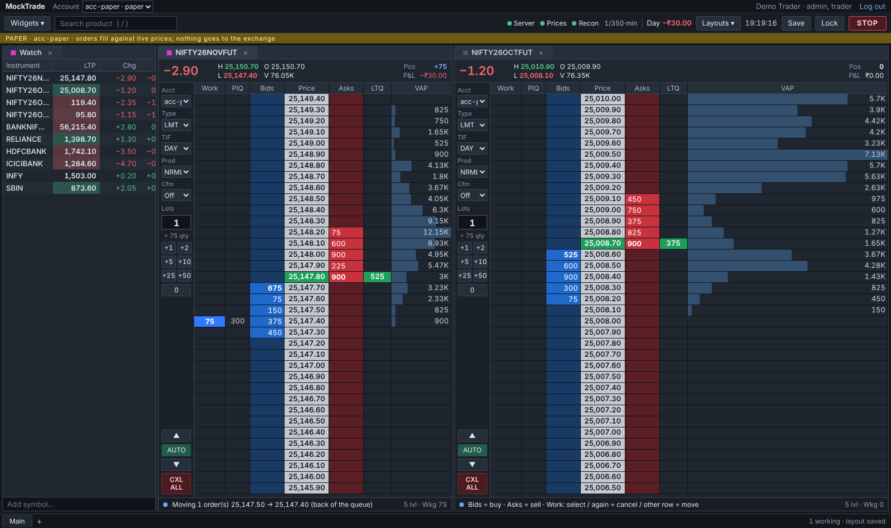
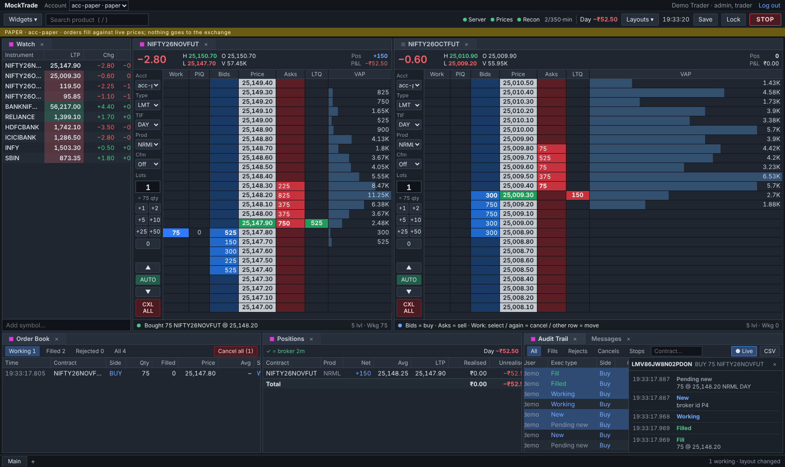
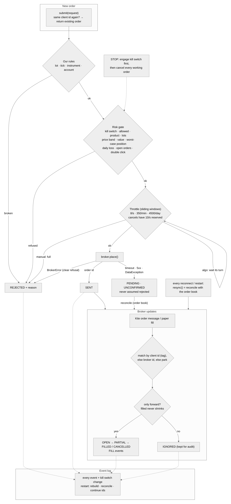

# MockTrade status and next steps

As of 15 Oct 2026 (India time). Code and context are integrated through K9.1 by the recovery for #204. GitHub issues are the source of truth.

**Current handoff:** next is **#200** (synthetic trailing stop, OCO and bracket), then #201 and #202. See [merge recovery](merge-recovery-2026-10-15.md). The historical table below records each original PR's checks; it is not a list of PRs still needing manual merges.

Ladder (K5.4) as built: 

Order book, positions, audit trail (K5.5) as built: 

## Active track: Kite Connect (NSE/BSE)
Decided 14 Oct 2026. MockTrade connects to the real Indian market through Zerodha Kite Connect. A paper broker fills orders against live Kite prices for testing without money. Design: `docs/design/kite-architecture.md` (diagrams in `context/images/kite-*.png`).

| Milestone | Issues | Outcome |
| --- | --- | --- |
| K0 · Foundations | #124–#127 | package, money in paise, instruments, order types, broker interface |
| K1 · Live prices | #128–#132 | Kite login, instrument list, binary tick decoder, WebSocket client, live terminal ladder |
| K2 · Paper broker | #133–#135 | fills vs live depth, queue position, latency, Kite-like rejects |
| K3 · Orders & risk | #136–#140 | order manager, throttle 8/s · 350/min · 4500/day, risk + kill switch, SQLite event log, real Kite adapter |
| K4 · Positions & P&L | #141–#142 | P&L from fills, reconcile with Kite |
| K5 · Server & screens | #143–#147, #156 | FastAPI + password/TOTP, browser WebSocket, **widget workspace** (dockview), ladder, blotter/positions/audit, **Electron desktop app** |
| K6 · Algos | #148–#151 | parent/child engine, slicer, two-leg spread, algo screen |
| K7 · Deploy & operate | #152–#155 | Docker Compose + Caddy, Lightsail Mumbai + static IP, latency measurement, runbooks |

Issue bodies were created by `context/backlog-scripts/kite_backlog.py` (+ `create_kite.py`). #145 was later rewritten (widget workspace) and #156 added (Electron) after Ayush asked for a desktop, widget-based front end.

## Build progress (Claude now writes the code, at Ayush's request on 14 Oct)
Ayush asked Claude to code the whole project professionally (extensive tests, careful code) while he follows along; he types "continue" when usage limits reset. The original PRs were stacked: each milestone's branch built on the previous one. New work starts from main, with context in the same PR.

| Milestone | PR | Status |
| --- | --- | --- |
| K0 Foundations (#124–#127) | #158 (base main) | ✅ CI green, 50 tests |
| K1 Live prices (#128–#132) | #159 (base k0-foundations) | ✅ CI green, 117 tests |
| K2 Paper broker (#133–#135) | #160 (base k1-live-prices) | ✅ 167 tests; each fill rule mutation-checked |
| K3.1 Order manager (#136) | #161 (base k2-paper-broker) | ✅ CI green, 52 tests, 15 mutations caught |
| K3.2 Throttle (#137) | #162 (base k3-1-order-manager) | ✅ CI green, 23 tests |
| K3.3 Risk checks + kill switch (#138) | #163 (base k3-2-throttle) | ✅ CI green, 48 tests |
| K3.4 Event log (#139) | #164 (base k3-3-risk) | ✅ CI green, 16 tests |
| K3.5 Kite order adapter (#140) | #165 (base k3-4-event-log) | ✅ CI green, 370 tests in total. Manual step left: AMO check on the server |
| K4.1 Positions & P&L + auto kill on daily loss (#141) | #166 (base k3-5-kite-orders) | ✅ CI green, 43 tests |
| K4.2 Reconcile positions with the broker (#142) | #167 (base k4-1-positions) | ✅ 424 tests in total |
| K5.1 Server + password/TOTP login + API (#143) | #168 (base k4-2-reconcile) | ✅ CI green; 21 security mutations checked |
| K5.2 Browser stream (#144) | #169 (base k5-1-server) | ✅ CI green, 490 tests; contract in docs/design/stream.md |
| UI design pass (mockups) | canvas "MockTrade UI design" (claude.ai artifact) | ✅ dense trading terminal; ladder (board 0, interactive) + workspace (board 2) redone; other boards still "old style" |
| K5.3 UI skeleton: workspace, login, watch list (#145) | #170 (base k5-2-stream) | ✅ CI green after a fix: `ui/src/lib/format.ts` had never been pushed (the Python `.gitignore` ignored every `lib/` folder); rebuilt with tests, `.gitignore` now ignores only `/lib/` |
| K5.4 Ladder (#146) | #171 (base k5-3-ui) | ✅ CI green; 112 UI + 509 Python tests, 13/13 mutations caught, paper trading checked end to end in a real browser |
| K5.5 Order book, positions, audit trail, messages (#147) | #172 (base k5-4-ladder) | ✅ CI green; 143 UI + 511 Python tests, 13/13 mutations caught, checked end to end in a real browser |
| Order ticket + **order spec** (#173) | #175 (base k5-5-screens, branch k5-5b-ticket) | ✅ 179 UI + 529 Python tests; all order types checked in a real browser |
| K5.6 Desktop app + pop-out windows (#156) | #176 (base k5-5b-ticket, branch k5-6-desktop) | ✅ 181 UI + 12 desktop + 529 Python tests; real Electron run under xvfb (pop-out live, pages can't reach Node, ~600 MB app, ~20–25 MB per pop-out). Ayush: build the installer on Windows (`ui/desktop/README.md`) |
| Stream sends changes at once (#177) | #178 (base k5-6-desktop, branch k5-7-fast-stream) | ✅ tick → browser ~200 ms → **1–6 ms**; the new latency test fails on the old code |
| K6.1 Algo engine (#148) | #179 (base k5-7-fast-stream, branch k6-1-algo-engine) | ✅ 545 Python tests, 12/12 mutations, paper-broker integration test |
| K6.2 Slicer (#149) | #180 (base k6-1-algo-engine, branch k6-2-slicer) | ✅ 555 Python tests, 8/8 mutations, 750 parent completed on paper |
| K6.3 Spreader (#150) | #181 (base k6-2-slicer, branch k6-3-spreader) | ✅ 567 Python tests, 11/12 mutations, NIFTY calendar spread on paper |
| K6.4 Algo screen (#151) | #182 (base k6-3-spreader, branch k6-4-algo-screen) | ✅ 572 Python + 197 UI tests, 12/12 UI mutations, slicer and spreader started from the browser and run to Done on paper |
| K7.1 Docker + Caddy (#152) | #184 (base k6-4-algo-screen, branch k7-1-docker) | ✅ 583 Python tests; real `docker compose up`: HTTPS via Caddy, login + ladder fill over proxied WebSocket, clean SIGTERM exit 0 |
| K7.1b Live Kite in serve (#183) | #185 (base k7-1-docker, branch k7-1b-live-kite) | ✅ 596 Python + 201 UI tests, fake-Kite tests 9, 12/12 mutations; real kite-mode run: strip + "Log in to Kite" to Zerodha with api_key/state |
| K7.2 Server set-up (#153) | #186 (base k7-1b-live-kite, branch k7-2-server) | ✅ 600 Python tests; backup + restore checked in real Docker; `deploy/server-setup.sh` (shellcheck clean); runbook `docs/runbooks/server.md`. **Ayush closes #153 after the AMO IP check (§5)** |
| K7.3 Metrics + load (#154) | #187 (base k7-2-server, branch k7-3-metrics) | ✅ 612 Python tests; `/api/metrics`; two-process load test with fake Kite; tick path 62→21 µs/tick, GC pauses 100→15 ms; results in `docs/design/performance.md` |
| K7.4 Ops: scheduler, alerts, runbooks (#155) | #188 (base k7-3-metrics, branch k7-4-ops) | ✅ 627 Python + 202 UI tests; whole simulated trading day test; runbooks `morning.md`, `incidents.md` |
| K8.1 Option pricing (#189) | #194 (base k7-4-ops, branch k8-1-pricing) | ✅ 813 Python tests, 16/16 mutations; Black-76 on the future, IV, Greeks in traders' units; `docs/design/options.md` |
| K8.2 Option chain (#190) | #195 (base k8-1-pricing, branch k8-2-chain) | ✅ 822 Python tests; REST + throttled stream `{"op":"chain"}`; simulator prices options by Black-76 + smile; checked live on the demo |
| K8.3 Chain widget (#191) | #196 (base k8-2-chain, branch k8-3-chain-widget) | ✅ 214 UI tests; real browser: live chain, click drives the ticket, maximize (double-click a tab) |
| K8.4 Strategy builder (#192) | #197 (base k8-3-chain-widget, branch k8-4-strategy) | ✅ 835 Python + 222 UI tests, 13/13 mutations; real browser: iron condor payoff, Alt-click legs from the chain |
| K8.5 Baskets (#193) | #198 (base k8-4-strategy, branch k8-5-baskets) | ✅ 844 Python + 224 UI tests; covered-short risk rule; real browser: iron condor checked and sent as one basket |
| K9.1 Execution algos (#199) | #203 (base k8-5-baskets, branch k9-1-exec-algos) | ✅ 867 Python + 225 UI; 17/17 mutations; real browser: TWAP, iceberg and POV run to Done |
| Fix: basket cover must be filled (#207) | #208 merged | ✅ 873 Python; 9/9 mutations (`context/scripts/mutate-basket-cover.py`) |
| Fix: rebuild state after a restart (#206) | #209 merged | ✅ 878 Python; 12/12 mutations (`context/scripts/mutate-recovery.py`); real demo restart: position, P&L and orders back, resting paper order closed with the reason |
| K9.2 Protection: trailing stop, OCO, bracket (#200) | #210 merged | ✅ 15 new tests; mutation check `context/scripts/mutate-protect.py`; real browser: bracket entered at market with target and stop, trailing stop following the highs (`context/scripts/e2e-protect.cjs`) |
| K9.3 GTT at the broker (#201) | #211 merged | ✅ 914 Python; GTT spec + risk at the trigger; Kite /gtt/triggers; paper simulation; fired orders adopted; design `docs/design/gtt.md` |
| K9.4 Orders+ screens (#202) | #212 merged | ✅ 239 UI tests; real browser: GTT OCO from the book, trailing stop and GTT from the ticket tabs, algos grouped by family (`context/scripts/e2e-orders-plus.cjs`) |
| K10.1 Funds, holdings, tradebook (#213) | #218 merged | ✅ 930 Python + 247 UI tests; optional broker ports (Kite `/portfolio/holdings`, `/user/margins`, `/trades`; paper cash model `broker/paper_funds.py`); `PortfolioService`; Funds + Holdings widgets, Trades tab; mutations 25/27 (2 equivalent); real browser on the demo (`context/scripts/e2e-portfolio.cjs`); design `docs/design/portfolio.md` |
| K10.2 Charges, P&L gross and net (#214) | #219 merged | ✅ 943 Python + 248 UI tests; `charges/` (model, schedule as data checked 15 Oct 2026 incl. Budget 2026 STT, service); Positions gross/charges/net; ticket estimate; mutations 20/20; real browser (`context/scripts/e2e-charges.cjs`); design `docs/design/charges.md` |
| K10.3 End-of-day report, P&L history, CSV/PDF (#215) | #220 merged | ✅ 949 Python + 253 UI tests; `reports/` (build from the audit trail, kept JSON at 16:00 IST, history by day/instrument/strategy, CSV, PDF writer with no dependency); Reports widget; mutations 20/20; real browser with downloads (`context/scripts/e2e-reports.cjs`); design `docs/design/reports.md` |
| K10.4 Pre-trade margin check (#216) | #221 merged | ✅ 961 Python + 256 UI tests; `risk/margin.py` `MarginGate` (exits never checked, fails open with `MARGIN_UNCHECKED`), paper margin quote, `POST …/margin`, ticket margin line; mutations 15/15; real browser (`context/scripts/e2e-margin.cjs`); design `docs/design/margin.md` |
| K10.5 MTM limits, square-off assistant (#217) | #222 merged | ✅ 971 Python + 260 UI tests; `risk/mtm.py`, `risk/squareoff.py`, `risk/closing.py`, `ops/guards.py`; MTM Limits widget, Square off MIS button; mutations 18/18; real browser (`context/scripts/e2e-mtm.cjs`); design `docs/design/mtm.md` |
| K11.1 Tick recorder (#223) | #227 merged | ✅ 983 Python tests; `MarketData.tap`, `research/ticks.py` (`TickRecorder`, `FileTickStore`), REST recordings, `MOCKTRADE_RECORD_DAYS`; 86.6 bytes/tick measured on the demo; mutations 14/14; design `docs/design/research.md` |
| K11.2 Replay into paper (#224) | #228 merged | ✅ 988 Python + 262 UI tests; `research/replay.py` (`ReplayFeed`, `ReplayClock`), `demo --replay <day>` (own data folder, every part on the replayed time), `PaperBroker(every_tick=True)`, `/api/replay`, replay bar + band; same fills as live (tested); mutations 11/11; real browser (`context/scripts/e2e-replay.cjs`) |
| K11.3 Backtest runner (#225) | branch k11-3-backtest | ✅ 996 Python tests; `research/backtest.py` (`run_day` deterministic on a fresh platform, drain between ticks, candles, `Backtests` kept runs, `CandleStore`), REST; hand-worked day; mutations 12/12; real run on the demo recording 0.3 s |

K3 flow: 

Historical stack order (integrated by the recovery PR; do not replay these merges): #123 → #157 → #158 → #159 → #160 → #161 → #162 → #163 → #164 → #165 → #166 → #167 → #168 → #169 → #170 → #171 → #172 → #175 → #176 → #178 → #179 → #180 → #181 → #182 → #184 → #185 → #186 → #187 → #188 → #194 → #195 → #196 → #197 → #198 → #203 → … (GitHub retargets stacked PRs automatically when their base merges).

**Design changes made while coding:**
- Kite REST uses **our own async httpx client** (not the synchronous SDK); the SDK stays only as a test reference (decoder equivalence test).
- `.gitignore` ignores only the top-level `/data/` (it had hidden `tests/data/`).
- CI uses actions/checkout@v5 and setup-python@v6 (Node 20 deprecation).
- Decoder measured at ~17 µs per full packet (≈1 % of a CPU at 750 ticks/s).
- Paper broker is conservative on purpose: fills at shown depth only, queue position from depth, volume counts only after we join, no price improvement for resting orders, triggered stops arrive as new orders. Shared rules (market protection, 25-modify cap) live in `broker/rules.py` so paper can't be more lenient than Kite.
- K3 is **one PR per issue** (stacked), not one per milestone: smaller reviews.
- Throttle uses **sliding windows**, not token buckets (a bucket of 8/s can let 15 out in one second). Cancels get 10/s reserved room; manual clicks are refused with "try again in X s" (rounded up); algos wait in order.
- Error meaning: BrokerError = clear refusal; any other exception = **unknown outcome** → UNCONFIRMED → reconcile. Kite's NetworkException/DataException/GeneralException/5xx/timeouts are unknown. Places are never retried automatically.
- Event log uses Python's built-in **sqlite3** (WAL, writer thread), not SQLAlchemy/Postgres yet: no dependency, fast enough; Postgres later = one new class.
- Money shown in lakh/crore grouping (`format_rupees`: ₹56,27,250.00).
- Positions: weighted average cost with **exact fractions** (no paise leak); applied by cumulative filled qty (replays never double count); carried positions seeded at the previous close (today's P&L starts at 0). P&L is gross (charges estimator later).
- Auto kill switch on the daily loss (`DailyLossWatch`), once per day so a reset lets you close.
- Position reconcile alerts only after **two checks in a row** (re-check in 10 s), so in-flight fills don't cause false alarms; never auto-corrects.
- Server security: Argon2id (not bcrypt) + TOTP once-only codes; lockout 5/15 min; per-IP limit; __Host- cookie (HttpOnly, Secure, SameSite=Strict), only the token's hash stored; Origin check + JSON-only for changes; security headers; no /docs. User/accounts/sessions in SQLite (`server/users.py`); TOTP secrets encrypted with `MOCKTRADE_SECRET_KEY`.
- `platform.py` wires each account (risk → throttle → manager → book → kill/loss watch → reconciler → event log).
- Stream: prices/positions conflated (250 ms, newest wins), orders never; slow browser closed with 4408 (never silent gaps); reconnect = hello → snapshots → merge by updated_at.
- Mutation testing now uses `scratchpad/mutate.py`-style harness that always restores files (a killed run once left a mutated line; the suite caught it).
- Ladder (K5.4): PIQ is estimated in the browser with the paper broker's own queue rule (Kite doesn't report it), so paper and live agree; VAP is counted on the server from every tick (`marketdata/vap.py`, `GET /api/instruments/{id}/vap`) and continued from the stream. The browser makes client order ids (a lost "place" answer can't double-place). Cancels are allowed while trading is stopped (`cancelBlock` vs `tradingBlock` in `ui/src/state/gate.ts`). Optional confirm-over (Cfm) per ladder.
- K5.5: `GET /api/accounts/{a}/events` = the account's audit trail newest first (`EventLog.page`), including its kill switch (`account <id>`) and the firm's. Audit exec types: SUBMITTED=Pending new, SENT=New, FILL=Fill/Partial fill, UPDATED=the new state (Working/Partial/Filled/Cancelled/Rejected), CANCEL_SENT=Pending cancel, MODIFY_SENT=Pending replace, KILL_SWITCH=STOP/Resume. Live audit catches up from the log 300 ms and 2 s after each order event and every 5 s (the log writes in a background thread). Order book and positions "drive" the link group (click = linked ladder switches). Grids scroll sideways in narrow windows. CSV export guards against spreadsheet formulas.
- **Order spec (#175): backend provides, frontend displays.** `GET /api/accounts/{a}/instruments/{id}/order-spec` (`domain/order_spec.py`) lists the broker's order types by what they need (price/trigger: required|none, market protection: auto|none), validities, named rules (`stop_trigger`, `stop_limit`), `priced_by_click`, plus products, tick, lot, auto protection %. Broker adapters publish `order_spec()` (Kite and paper share `broker/rules.order_spec`); the order manager enforces it. Ticket and ladder draw from it (`useOrderSpec`), nothing hard-coded. Apply the same pattern to everything new (algo parameters, products, limits, permissions).
- **Pop-outs (#176):** a widget's window loads `/popout.html` and is drawn by the main page (dockview `addPopoutGroup`), so it shares the one WebSocket/store/link groups: zero sync delay. `/popout.html` has its own CSP (inline styles yes, scripts never). Desktop app = `ui/desktop/` (Electron 44, opens the server, https only; `src/security.ts` rules tested). Electron's binary download fails through Node here: fetch the zip with curl and unpack into `node_modules/electron/dist` + `path.txt` (see how it was done in the #176 session); CI skips the binary (`ELECTRON_SKIP_BINARY_DOWNLOAD=1`).
- **Speed (Ayush, 14 Oct): "ensure syncing and latency are very fast from our side".** Measure every hop (K7.3) and remove waits we add: first change goes out at once, conflation only during bursts.
- **Algo engine (K6.1):** `algos/engine.py` + `algos/spec.py`, design `docs/design/algos.md`. Children marked by `parent_id` (`OrderRequest.from_algo`); `algo_id` = exchange-issued id only (none yet). In-flight children count against the parent; a parent isn't final while one is in flight. `AccountRuntime.algos`; `Platform.add_account(algo_types=...)`.
- **Spreader (#181):** hedges on every child update; keeps hedges on pause/stop; done only when both legs complete; UNHEDGED → ALERT event; 3 refusals in a row while stopping → give up (FAILED). Engine hooks `done()`, `keep_on_stop()`, `on_finish()`, `ctx.report()`, `ctx.send(hedge=True)`.
- Stream (#178): wait for a change → send at once if nothing went out in the last 250 ms, else wait the rest and send the newest. Measured 1–6 ms tick → browser (was ~200 ms).
- Paper refuses stops whose trigger the market already passed (Kite does too); SL trigger vs limit checked in `OrderRequest.validate`.
- Ticket "confirm" is derived from the exact order (`armedFor === signature`), not reset by an effect: an effect-based reset caused a timing-dependent test failure.
- Lesson (K5.3): before pushing, check `git status --ignored` for source files hidden by `.gitignore`.
- Risk: reducing a position is always allowed (even past limits or the daily loss); worst-case position counts working orders; option selling to open is off by default.

**UI direction (Ayush, 14 Oct, after the first mockups):** the first mockups looked like an AI-designed website. The UI must look and work like a professional trading terminal: dense multi-window workspace, many small click-to-trade ladders (Work | Bids | Price | Asks | LTQ | VAP, qty preset buttons, L/M and TIF on the side; click bid = buy, ask = sell, Work = cancel), compact grids (orders, positions, audit trail), tiny window chrome, 11–12 px type. Ladders follow common professional patterns; never copy or name any other vendor's product (Ayush plans to deploy MockTrade commercially in India later). Very convenient for the user above all.

**UI plan (promised 14 Oct):** before any UI code, a UI design pass with mockups for approval: dark-first design system, workspace model (dock/tab/pop-out/linked widgets), every screen (ladder, ticket, blotter, positions, audit, algo manager, admin, morning login), interaction and safety rules.

## Next
**Where we are (16 Oct 2026):** K0–K10 are merged on `main` (K10: PRs #218–#222). K11 has started. Safety fixes #206 and #207 are merged. Main CI is green. **Claude merges its own PRs once CI is green** (Ayush, 15 Oct). K10 issues exist: #213 (K10.1), #214 (K10.2), #215 (K10.3), #216 (K10.4), #217 (K10.5).

1. **K10.1 (#213) is merged** (PR #218). See `docs/design/portfolio.md`: optional ports `FundsSource`/`HoldingsSource`/`TradesSource`; `PortfolioService` (`AccountRuntime.portfolio`: cached, one read per kind, stale-not-empty with `as_of`/`error`, refresh 0.5 s after fills, holdings live-marked); REST `GET /api/accounts/{a}/funds|holdings|trades[?fresh=true]`; stream type `portfolio`; paper money in `broker/paper_funds.py` (`PaperMargins`, `MOCKTRADE_PAPER_FUNDS`); recovery hands paper CNC over as holdings; UI `ui/src/widgets/portfolio/` (Funds, Holdings, TradesTable in the order book).
2. **K10.2 (#214) is merged** (PR #219). See `docs/design/charges.md`.
3. **K10.3 (#215) is merged** (PR #220). See `docs/design/reports.md`.
4. **K10.4 (#216) is merged** (PR #221). See `docs/design/margin.md`.
5. **K10.5 (#217) is merged** (PR #222). **K10 is complete.**
6. **K11 research, issues created:** #223 K11.1 tick recorder, #224 K11.2 replay into paper, #225 K11.3 backtest runner, #226 K11.4 research screens. K11.1 and K11.2 are merged (PRs #227, #228). **K11.3 (#225) is done** on branch `k11-3-backtest` (PR "Closes #225"; merge on green CI if still open). See `docs/design/research.md`. **Next: K11.4 #226 research screens** (all data from the server): Recordings widget (`GET /api/research/recordings[/day]`: days × ticks × bytes, instruments), Backtests widget (form drawn from `GET /api/accounts/{a}/algo-specs` reusing the algo form pieces; days picked from recordings; runs list with progress polling `GET /api/research/backtests`; a run's summary, equity curve (SVG line), daily table, trades), Compare (two or more runs side by side), CSV/PDF of a run's day via the K10.3 exporters (add `GET /api/research/backtests/{run}/days/{day}?format=csv|pdf`). Then K11 is complete; next K12 charts & alerts (create its issues first).
7. Then K12 charts & alerts (charts with trade marks, price/%/volume/OI alerts in app and by webhook, time & sales, depth, movers), K13 admin & phone (admin panel, per-user limits, phone screens, keyboard shortcut editor, themes). See `docs/design/product-vision.md`.
8. Ayush's own steps (not code): `docs/runbooks/server.md` (AWS Mumbai, static IP, Kite app ₹500/month, AMO check), then a real trading day; before selling to others: the broker's multi-user arrangement, exchange algo empanelment, licensed market data, legal review.

**How each piece is built (keep the quality):** brainstorm the traps → code with the "backend provides, frontend displays" rule (specs from the server, no market rules in the UI) → Python tests + UI tests → a mutation script in `context/scripts/mutate-*.py` (restores files in `finally`, a hang counts as caught; **run one at a time, never kill one mid-run**: it can leave a mutant in the source) → real browser or real server check against the demo (`context/scripts/e2e-*.cjs`) → docs in `docs/design/` → context files → PR → green CI → merge.

**Session lessons:** anchor `pkill -f` patterns with `^` (an unanchored pattern matches the calling shell and kills it); TOTP codes are single-use: wait for the next 30 s window before logging in again; `rm -rf data/demo` for a fresh demo; rebuild `ui/dist` before browser checks; positions add up across demo runs (±1500 limit).

## Earlier notes
- K6 algo engine: new algos need only a strategy + `AlgoSpec` registered in `algos/builtin.py`; the screen draws them. Live Kite: `broker/kite/live.py`; server entry `python -m mocktrade.tools.serve`; Docker in a cloud session: start `dockerd`, pull from `mirror.gcr.io/library/<image>`, proxy CA only in local base images.

## Key facts the design depends on (checked 14 Oct 2026, re-check before going live)
- Data ₹500/month per app; order APIs free.
- About 1 tick per second per instrument (sometimes 2); full mode 184 bytes with 5 bid + 5 ask depth; big-endian; prices in paise.
- 3000 instruments per WebSocket, 3 connections per API key.
- Orders 10/s, 400/min, 5000/day per user; 25 modifications per order; quote API 1/s.
- Access token expires 6 AM next day; manual login daily.
- Static IP required for order endpoints only (1 primary + 1 backup), set in developer console → IP Whitelist.
- MARKET and SL-M orders need market_protection −1 or 1–100 (0 rejected).
- SEBI: ≤ 10 orders/s per segment without exchange registration; personal use only; no open APIs.

## Paused: COMEX/MockCME track
Old milestones Phase 0–8 and v0.1–v1.0 stay open but their 95 open issues carry the label `paused: cme-track`. The build map (`context/build-map/`) describes that track.

## Tool limits seen in Claude's GitHub access
- GraphQL blocked: no Projects boards or issue transfers from Claude; Ayush does those.
- Repo settings and new repos: Ayush does those.
