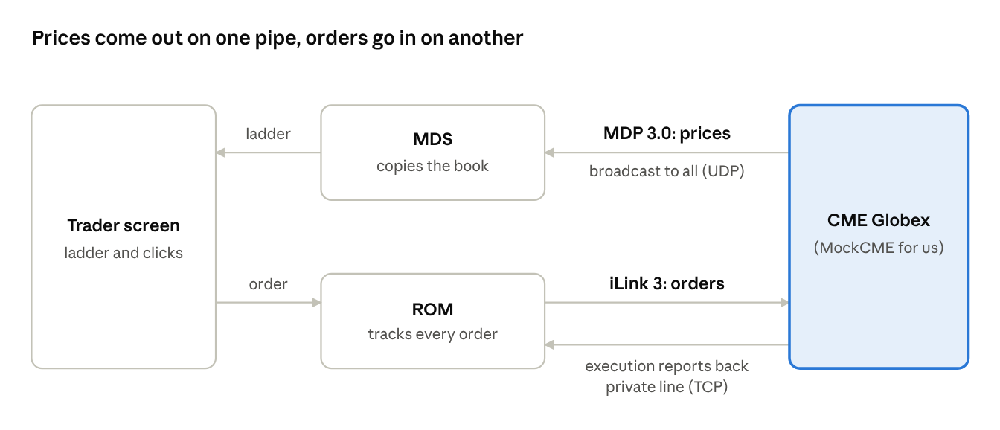
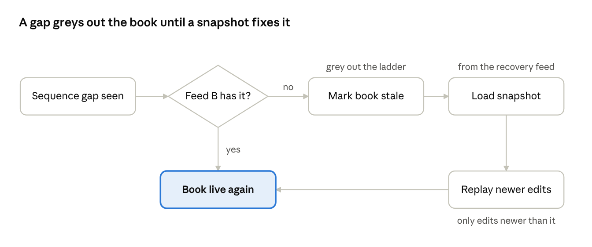
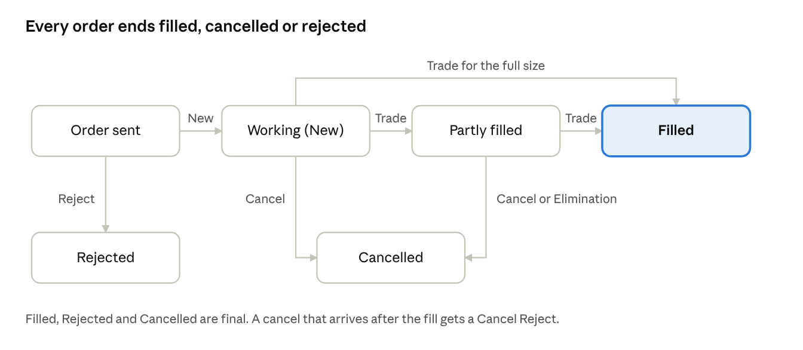

# CME Wiki Explained for Laddrix

Written 12 Oct 2026 for Laddrix issues #15 and #16. Originally a Claude Doc; this is the repo copy.

## Start here

From the whole CME wiki, you need two specs: **MDP 3.0**, which brings prices to you, and **iLink 3**, which takes your orders to the exchange. Everything else on the wiki is setup, certification or other products, and you can skip it.

Think of the exchange as a shop with two windows:

- **The notice board (MDP 3.0).** The exchange shouts every price change to everyone at once. You listen, and you can't talk back. Issue #15 covers this.
- **The counter (iLink 3).** You walk up alone, hand over an order slip and get a receipt back. It's a private two-way conversation. Issue #16 covers this.

Laddrix needs both. Your **MockCME** will shout prices and serve the counter, your **MDS** will listen to the board, and your **ROM** will stand at the counter.

Prices only ever flow out of the exchange on MDP 3.0. Orders go in, and receipts come back, on iLink 3.

**How to read this guide:** go in order and spend about 20 minutes per section. After each one, say its idea out loud in one sentence. If you can't, read it again before you move on. Every term is explained the first time it appears, and there is a glossary at the end.

**One honest note:** the wiki pages load with JavaScript, and my tools couldn't open their text. This guide is written from CME's public specs, which have been stable for years, and it links to the wiki pages. Message numbers and field names can change between spec versions, so check them on the wiki when you write adapter code. The ideas themselves won't change.

## Basics from zero

Six words show up on every page of the wiki. Learn these first and the rest is easy.

| Word | Plain meaning | Everyday picture |
| --- | --- | --- |
| **Exchange** | The computer that matches buyers and sellers. For you, that's CME Globex in Aurora, near Chicago. | The shop |
| **Order book** | The list of everyone waiting to buy (bids) and sell (offers) at each price. | The queue at each counter |
| **Message** | One small packet of facts, like "bid at 2400.4 is now 7 lots". | A text message |
| **Protocol** | The agreed rules for which messages exist, in what order and with what fields. MDP 3.0 and iLink 3 are protocols. | Grammar for a language |
| **Binary encoding** | Numbers are sent as raw bytes, not readable text. This is faster for computers but unreadable for humans without a decoder. | Shorthand only both sides know |
| **Latency** | Time from something happening to you knowing or acting on it. | Delay on a phone call |

### Two ways to send data: UDP multicast vs TCP

This is the most important basic idea, because the two specs use different ones.

|  | **UDP multicast** (used by MDP 3.0) | **TCP** (used by iLink 3) |
| --- | --- | --- |
| Picture | A radio broadcast | A phone call |
| Who receives | Everyone tuned in, all at once | Only you |
| Lost packets | Gone. Nobody resends them automatically. | Resent automatically, in order |
| Speed | Fastest. One send reaches thousands. | A bit slower, but reliable |
| What you must do | Notice gaps and recover them yourself (section 5) | Keep the call alive with heartbeats (section 7) |

Why CME picked these: prices must reach every firm at the same moment, so they're broadcast. Orders are private and must never be lost, so they go over a call.

**For Laddrix:** you don't need real multicast on your laptop. Your MockCME can publish prices over any channel (for example a local socket or a queue). Copy the *ideas* (sequence numbers, gaps, recovery), not the network wiring.

## MDP 3.0, part 1: how prices reach you

MDP 3.0 (Market Data Platform, version 3) is CME's broadcast of every price change. It's organized as **channels**, each with **three kinds of feed**, and each feed is sent **twice** (A and B). Wiki page: [MDP 3.0 Message Specification](https://cmegroupclientsite.atlassian.net/wiki/x/YzJCGw).

### Channels: one radio station per product group

CME splits products into channels, so you only listen to what you trade. COMEX metals (GC, SI, HG and their spreads) sit together on a metals channel. Laddrix can start with one channel.

### Three feeds per channel

| Feed | What it says | When you listen | Laddrix part |
| --- | --- | --- | --- |
| **Incremental** | Every change, as it happens: "level 2 bid is now 7 lots", "trade at 2400.5 for 3" | All day. This is the main feed. | MockCME publishes it, MDS reads it |
| **Market Recovery** (snapshot) | A full photo of each book, repeated on a loop | Only at startup or after you've lost packets | MockCME loops snapshots, MDS uses them to recover |
| **Instrument Definition** | The list of instruments and their rules: tick size, legs, expiry | At startup, to learn what exists | Your instrument service |

The picture to remember: **incremental = the live commentary, snapshot = the scoreboard, definitions = the team sheet.**

### Feed A and Feed B: the same broadcast, twice

Every feed is sent on two separate network paths with identical content. You listen to both and take whichever copy of each packet arrives first. If one path drops a packet, the other usually has it. This is called **A/B arbitration**. For Laddrix it's a "later" feature (v0.6 failure work), not a day-one need.

### Inside a packet

One UDP packet carries one or more messages:

1. **Packet header:** `MsgSeqNum`, the packet's number on this channel (1, 2, 3 …), and `SendingTime`, when CME sent it, in nanoseconds.
2. Then one or more **messages**, each starting with its size and a small header that says which **template** (message type) it is.

### The main message types

| Message | What it carries | You need it? |
| --- | --- | --- |
| `MDIncrementalRefreshBook` | Changes to price levels in the book | Yes, core |
| `MDIncrementalRefreshTradeSummary` | Trades: price, quantity, which side was the aggressor | Yes, for Time & Sales (#120) |
| `SecurityStatus` | Trading state changes: pre-open, open, halt, close | Yes |
| `MDInstrumentDefinitionFuture` / `…Spread` | What an outright or spread is | Yes |
| `SnapshotFullRefresh` | Full book photo on the recovery feed | Yes, for recovery |
| `MDIncrementalRefreshDailyStatistics` / `SessionStatistics` | Settlement price, open, high, low, open interest | Settlement is needed for P&L (#20); the rest is nice to have |
| `ChannelReset` | "Throw away all books on this channel and start again" | Yes, rare but important |
| `MDIncrementalRefreshOrderBook` (Market by Order) | Every single order, not just levels | Skip for now |

### Prices are whole numbers

To avoid decimal rounding errors, CME sends prices as a whole number with a fixed number of decimal places implied. For example 2400.5 is sent as 2400500000000 with exponent −9, meaning "divide by one billion". **Copy this idea:** store prices in Laddrix as integer ticks or fixed decimals, never as floats.

## MDP 3.0, part 2: building the book

The exchange never sends you "the ladder". It sends small edits, and your MDS applies them in order to keep its own copy of the book. If you apply every edit correctly, your copy matches CME's exactly. This is the core skill of #15.

### Market by Price (MBP): levels, not orders

MBP groups all orders at one price into one **level**: price, total quantity and number of orders. For futures, CME sends the top **10 levels** each side. Level 1 is the best price (highest bid, lowest offer).

### Each edit says four things

| Field | Meaning | Example |
| --- | --- | --- |
| `MDUpdateAction` | What to do: New, Change or Delete (plus a few rare ones below) | New |
| `MDEntryType` | Which side: Bid, Offer, Implied Bid, Implied Offer | Bid |
| `MDPriceLevel` | Which level, 1 to 10 | 2 |
| `MDEntryPx`, `MDEntrySize`, `NumberOfOrders` | Price, total lots, how many orders | 2400.3, 7, 2 |

Each edit also carries `SecurityID` (which instrument) and `RptSeq` (that instrument's own edit counter, see section 5).

### The three actions, worked through

Start with this bid side:

| Level | Price | Qty |
| --- | --- | --- |
| 1 | 2400.4 | 5 |
| 2 | 2400.2 | 8 |
| 3 | 2400.1 | 4 |

1. **New, level 2, 2400.3 × 7.** Insert at level 2 and push everything below it down one. The book is now 2400.4 / **2400.3** / 2400.2 / 2400.1. Anything pushed past level 10 falls off.
2. **Change, level 1, 2400.4 × 9.** Same price, new quantity. Nothing moves.
3. **Delete, level 2.** Remove level 2 and pull everything below it up one. The book is back to 2400.4 / 2400.2 / 2400.1.

The rare actions: **Delete Thru** clears the whole side, **Delete From** clears level N and everything worse, and **Overlay** replaces a level's price in place. Implement New, Change and Delete first, then the rare ones.

### Implied prices: prices the exchange builds from other books

CME runs **implied** matching: if you can buy the Dec gold outright and sell the Feb outright, that together forms a Dec–Feb spread price, even if nobody has quoted the spread itself.

- **Implied in:** a spread price made from the two outright legs.
- **Implied out:** an outright price made from a spread plus the other leg.

Implied prices arrive as separate entry types (Implied Bid, Implied Offer), usually only 2 levels deep. The ladder a trader sees is the **real book and implied book merged** at each price.

**Why this matters to you:** this is the same idea as your synthetic ladder (#61), except the exchange does it. Learn how CME merges them, and you'll understand exactly what a spread trader's ladder shows.

### Trades

`MDIncrementalRefreshTradeSummary` reports each trade: price, quantity, number of orders and the **aggressor side** (did a buyer or a seller cross the spread?). Book edits caused by that trade follow right after. That's exactly what your Time & Sales (#120) shows.

### Edits come in bundles

One event (one aggressive order sweeping two levels, say) can produce many edits. CME marks the last message of an event with an **end-of-event** flag. **Rule:** apply all the edits, but only show the ladder to the trader once end-of-event arrives. Otherwise the trader sees a half-updated book, sometimes even with the bid above the offer.

## MDP 3.0, part 3: gaps and recovery

If you miss even one edit, your book is wrong and you might not know it. A trader would then click on a price that isn't there. So MDP gives every packet and every instrument a counter, and you check them constantly. Wiki pages: [Recovery Services](https://cmegroupclientsite.atlassian.net/wiki/x/Fz1CGw) and [MBP Book Recovery Methods](https://cmegroupclientsite.atlassian.net/wiki/x/io7AAg).

### Two counters

| Counter | Counts | Picture | A gap means |
| --- | --- | --- | --- |
| `MsgSeqNum` | Packets on the whole channel | Page numbers of the newspaper | You lost a packet. Some book on this channel *might* be wrong. |
| `RptSeq` | Edits to one instrument | Page numbers of one chapter | That specific instrument's book *is* wrong |

Example: you've seen packets 101, 102, then 104. Packet 103 is missing. Wait a tiny moment for feed B's copy of 103. If it never comes, check the `RptSeq` of each instrument in the next packets to find which books are now broken.

### The recovery steps

1. **Notice the gap** (sequence number jumped).
2. **Try the other feed** (A/B). Most gaps end here.
3. **Mark the broken books as stale.** Tell the UI "this ladder can't be trusted" and grey it out. Never show a wrong book as if it were right.
4. **Join the Market Recovery feed.** Wait for the snapshot of each broken instrument to come round on the loop. Each snapshot carries the `RptSeq` it is correct up to, and the channel's `LastMsgSeqNumProcessed`.
5. **Replace the book with the snapshot**, then apply only the incremental edits *newer* than the snapshot's counter. Throw away older ones.
6. **Mark the book live again** and leave the recovery feed.

Most gaps end at the first question. The snapshot path is the safety net for the rest.

Startup works the same way: you start with no books, so you take snapshots for everything and then switch to the live feed. CME calls this **late join**.

### Natural refresh: a cheaper option

Some firms skip snapshots and just wait: every level gets rewritten eventually as the market moves. It's simpler, but the book can stay wrong for minutes in a quiet market. **For Laddrix, use snapshots.** Your brief says no wrong prices.

### For Laddrix

- Number your MockCME packets and per-instrument edits the same way.
- Add a test switch to MockCME that drops a packet on purpose. Your MDS must catch it, mark stale, recover and go live. This is a great v0.6 failure test.
- Stale marking should flow to the ladder UI (US-03), so the trader *sees* when not to trust a price.

## Instruments and trading states

Before you can build a book, you must know what the instrument *is*. The **Security Definition** messages tell you, and **Security Status** tells you whether it can trade right now. This feeds #17 (product facts) and #21 (domain model).

### What a Security Definition contains

| Field | Meaning | Gold example |
| --- | --- | --- |
| `SecurityID` | CME's number for the instrument. Every other message uses it. | a number like 123456 |
| `Symbol` | Human name: product + month code + year | GCZ6 = gold, December 2026 |
| `SecurityGroup` / `Asset` | Product family | GC |
| `MinPriceIncrement` | **Tick size**, the smallest price step | 0.10 ($ per ounce) |
| `UnitOfMeasureQty` | Contract size | 100 troy ounces |
| `DisplayFactor` | How to turn the sent price into the shown price | — |
| `MaturityMonthYear` | Expiry month | 202612 |
| `MarketSegmentID` | Which matching-engine group runs it | — |
| `SecurityTradingStatus` | Its state at the time of the definition | Open |

**Tick value** = tick size × contract size. The money one tick moves:

| Product | Tick size | Contract size | Tick value |
| --- | --- | --- | --- |
| GC gold | 0.10 $/oz | 100 oz | $10 |
| SI silver | 0.005 $/oz | 5,000 oz | $25 |
| HG copper | 0.0005 $/lb | 25,000 lb | $12.50 |

Check these against CME's contract specs page when you do #17. They change rarely, but they do change.

**Month codes:** F Jan, G Feb, H Mar, J Apr, K May, M Jun, N Jul, Q Aug, U Sep, V Oct, X Nov, Z Dec.

### Spreads are instruments too

A calendar spread like GCZ6–GCG7 has its own `SecurityID`, its own book and a **legs list**. Each leg says which outright, which side (buy or sell) and what ratio. A butterfly has 3 legs (1:−2:1) and a condor has 4. This is exactly your multi-leg model from the brief, so copy CME's leg structure into your domain model (#21).

Two kinds of spread to know:

- **Exchange-listed spreads:** CME creates and lists them, and they come on the definition feed.
- **User-defined spreads (UDS):** a trader asks CME to create a new combination through iLink 3, and it appears on the feed afterwards.

Your **synthetic** spreads (#61) are a third kind: they exist only inside Laddrix, built by your spreader from the legs. The exchange never knows about them.

### Trading states (Security Status)

An instrument moves through states during the day. Your MockCME must enforce them, and your ROM must respect them.

| State | What is allowed |
| --- | --- |
| **Pre-open** | Enter and cancel orders, but nothing matches yet |
| **Pre-cross / No cancel** | The last seconds before the open. Orders are frozen. |
| **Open** | Normal trading and matching |
| **Pause / Halt** | Trading stopped (for example after a sudden price jump) |
| **Close** | Market shut. Day orders are removed, GTC orders stay. |

At the open, CME runs an **opening auction**: it finds the single price that matches the most quantity, and everything crosses at once. Keep this as a later feature (v0.7) for your MockCME.

### Two exchange protections to copy

- **Price banding:** an order priced too far from the current market is rejected. This stops "fat finger" mistakes.
- **Velocity logic:** if the price moves too far too fast, CME briefly pauses the instrument.

Both are cheap to build in MockCME, and they make your mock behave like the real thing.

## iLink 3, part 1: opening the line (session layer)

iLink 3 is how a firm sends orders to CME Globex. It has two layers: the **session layer**, which keeps the phone line trustworthy, and the **application layer**, which carries the actual orders (part 2). Wiki page: [iLink 3 Binary Order Entry](https://cmegroupclientsite.atlassian.net/wiki/x/q5PEAg).

The session layer follows a standard called **FIXP** (FIX Performance). It's a lighter, faster cousin of the classic FIX protocol used across the industry. Learning it here teaches you how most exchanges handle sessions.

### The words

| Word | Plain meaning |
| --- | --- |
| **Session** | One logged-in line between a firm and the exchange. A firm can have many. |
| **UUID** | A unique ID for the session, chosen by the firm. It stays the same all week so both sides know it's "the same conversation". |
| **Sequence number** | Every business message is numbered, separately in each direction. |
| **Heartbeat** | A "still here" message sent when nothing else has been sent for a while |
| **Keep-alive interval** | How long silence is allowed before the other side assumes you're gone |
| **HMAC signature** | A cryptographic stamp that proves the login really came from you, using a secret key from CME. It's like a password that is never sent. |

### The steps of a session

| Step | Firm sends | CME replies | Plain meaning |
| --- | --- | --- | --- |
| 1. Negotiate | `Negotiate` | `NegotiationResponse` | "Hello, this is session X, here's my signed ID." Done once per UUID. |
| 2. Establish | `Establish` | `EstablishmentAck` | "Let's start talking. Here's my keep-alive interval and my next sequence number." CME replies with its own next number. |
| 3. Trade | orders | execution reports | Part 2 |
| 4. Stay alive | `Sequence` (heartbeat) | `Sequence` | Sent during quiet periods |
| 5. Fill gaps | `RetransmitRequest` | `Retransmission` + the old messages | "I missed your messages 41 to 45, send them again." |
| 6. Close | `Terminate` | `Terminate` | Polite goodbye |

### Sequence numbers on TCP: why still needed?

TCP doesn't lose bytes *while* connected. But if the connection drops and you reconnect, messages sent during the drop are gone. On reconnect, both sides compare numbers ("I'm expecting 46 from you"). If someone is behind, they ask for a retransmission. **That's how no execution report is ever lost**, which is your brief's "no accepted order is lost" rule.

### For Laddrix

Your ROM ↔ MockCME line should copy this, simplified:

- A login step with a session ID.
- Numbered messages in both directions.
- Heartbeats, with a timeout that triggers Cancel on Disconnect (section 9).
- Gap fill on reconnect.

Skip HMAC signing and real FIXP framing at first, and add them later if you want the practice.

## iLink 3, part 2: orders and receipts

You send three kinds of request (new, modify, cancel). The exchange answers every one with an **Execution Report**, the receipt that tells you what happened. Learn these four and you understand order entry on any exchange.

### What you send

| Message | Plain meaning | Key fields |
| --- | --- | --- |
| `NewOrderSingle` | "Place this order" | side, price, quantity, order type, time in force, instrument, your order ID |
| `OrderCancelReplaceRequest` | "Change my order" (price or quantity) | your order ID, CME's order ID, new price or quantity |
| `OrderCancelRequest` | "Cancel my order" | your order ID, CME's order ID |
| `OrderMassActionRequest` | "Cancel all my orders" (for one instrument, or all) | scope |
| `PartyDetailsDefinitionRequest` | Register who is trading: account, trader, firm. Each order then just points to it by ID. | party details ID |

**Note:** professional platforms register trader identity once in the same way, and every order then points to it by ID.

### The most important order fields

| Field | Meaning | Values to know |
| --- | --- | --- |
| `ClOrdID` | **Your** ID for the order. You choose it, and it must be unique. | e.g. MT-000123 |
| `OrderID` | **CME's** ID for the order, given in the first receipt | — |
| `Side` | Buy or sell | 1 Buy, 2 Sell |
| `OrdType` | Kind of order | Limit, Market-limit, Stop-limit |
| `TimeInForce` | How long it lives | Day, GTC, FAK (fill what you can, kill the rest), FOK (all or nothing), GTD (good till date) |
| `OrderQty`, `Price` | Size and limit price | — |
| `DisplayQty` | Show only part of the size (an **iceberg** order) | — |
| `ManualOrderIndicator` | Was this typed by a human or sent by an algo? CME *requires* this flag. | Manual / Automated |

That last field matters for you: your spreader and algos must mark their orders as automated, and clicks on the ladder as manual.

### What comes back: Execution Reports

| Report | Plain meaning |
| --- | --- |
| **New** | Accepted and resting in the book |
| **Reject** | Refused, with a reason (bad price, outside banding, wrong state…) |
| **Modify** | Your change was applied |
| **Cancel** | Your order is gone |
| **Trade** (outright, spread, spread leg) | You got filled, partly or fully. A spread fill also sends one report per leg. |
| **Elimination** | The exchange removed your order itself (end of day, FAK leftover, Cancel on Disconnect) |
| **Cancel Reject / Replace Reject** | Your cancel or modify failed, usually because the order already filled |

Each arrow is one Execution Report. Your ROM stores the order's state and moves it only when a report arrives.

Every report carries the running totals: `CumQty` (filled so far), `LeavesQty` (still working), `LastQty` and `LastPx` (this fill) and `OrdStatus`.

### The race you must handle

You send a cancel at the same moment your order fills. The fill wins. You get a **Trade** report and then a **Cancel Reject**. Your ROM must never assume a cancel worked until the Cancel report arrives. This is the #1 beginner bug in order management.

### For Laddrix

This section *is* the contract between your ROM and MockCME (#28 message dictionary). Use the same names (New, Reject, Trade, Cancel, Elimination) in your own neutral messages, keep both IDs (yours and the exchange's) on every order, and write a test for the cancel-vs-fill race.

## iLink 3, part 3: safety features

The exchange protects itself and you with five tools. Each one is a small feature you can copy into MockCME or your ROM, and each makes a good issue on its own.

| Feature | What it does | Why it exists | Where in Laddrix |
| --- | --- | --- | --- |
| **Cancel on Disconnect (CoD)** | If your session goes silent past the keep-alive time, CME cancels all your working orders | A crashed trading system can't leave orders it no longer knows about | MockCME, triggered by heartbeat timeout |
| **Throttle** | Limits messages per second per session. Extra messages are rejected. | One runaway algo can't flood the exchange | MockCME rejects; your ROM should also self-limit first |
| **Self-Match Prevention (SMP)** | Stops your buy from trading against your own sell. CME cancels the resting or the new order, whichever you choose. | Trading with yourself is a compliance problem (wash trading) | Your risk checks (#45), or in MockCME |
| **Mass cancel / Kill switch** | One message (or a firm-level button) cancels everything | Emergency stop | Your admin panel and ROM (#96) |
| **Price banding** (from section 6) | Rejects orders too far from the market | Fat-finger protection | MockCME |

**Connect to your brief:** "No order reaches an exchange without passing risk checks." CME's checks are the *last* line of defence. Your ROM's checks (max size, max position) are the *first*. Real firms have both, so Laddrix should too.

### One more related service: Drop Copy

CME also sends a firm a **copy of every execution report** on a separate line, called Drop Copy. Back offices and risk teams use it to rebuild positions independently of the trading system. That's the stream an accounts office reads to build positions and P&L. In Laddrix, MockCME can publish a drop copy stream that your accounts and P&L service reads. You can read the Drop Copy page on the wiki at overview level only.

## SBE encoding: just the idea

Both MDP 3.0 and iLink 3 use **SBE (Simple Binary Encoding)** to turn messages into bytes. You only need the idea, not the byte tables.

- **Fixed positions.** Every field sits at a known byte offset, like boxes on a printed form. To read the price, jump straight to byte 20, with no searching or parsing.
- **A schema file (XML)** lists every message, field, type and offset. CME publishes it ([Message Schema](https://cmegroupclientsite.atlassian.net/wiki/x/YzJCGw) is linked from the spec page). Code generators read it and write the encoder and decoder for you.
- **Every message starts with a small header:** block length, template ID (which message), schema ID and version.

Compare: the text `35=D|44=2400.5|38=3|` (classic FIX) must be scanned character by character, while SBE puts the price at byte N as an integer. That's why SBE is much faster.

**For Laddrix:** start with plain JSON or Python dataclasses between your services, because it's easy to debug. Your CME adapter is the only place that would ever speak SBE. Later, swapping your internal format to a binary one is a good latency exercise for v0.6.

## Generic vs CME-only: where each idea goes

Most of what you just read works on *every* exchange. Put that in Laddrix's core. Only names, numbers and byte formats are CME's own, and they belong in the CME adapter alone. Use this table as the template for your notes in #15 and #16.

| Idea | Generic, so it goes in the core | CME-only, so it goes in the adapter |
| --- | --- | --- |
| Order book | Price levels, bid and offer sides, quantity, order count | 10-level depth limit, `MDPriceLevel` numbering |
| Book edits | New, change, delete a level | `MDUpdateAction` codes 0 to 5, Overlay |
| Event bundles | Show the book only when an event is complete | The end-of-event flag's name and bit |
| Sequence numbers | Packet counter and per-instrument counter, detect gaps | `MsgSeqNum`, `RptSeq`, `LastMsgSeqNumProcessed` |
| Recovery | Mark stale, take a snapshot, replay newer edits | Market Recovery feed, A/B arbitration |
| Instruments | ID, tick size, contract size, expiry, legs with side and ratio | `SecurityID` numbers, month codes, `DisplayFactor` |
| Prices | Integers or fixed decimals, never floats | Exponent −9 (PRICE9) |
| Trading states | Pre-open, open, halt, close, and what each allows | `SecurityTradingStatus` code numbers |
| Session | Login, numbered messages, heartbeats, gap fill, logout | FIXP, `Negotiate`/`Establish`, HMAC |
| Orders | New, modify, cancel, mass cancel; Day/GTC/FAK/FOK | `NewOrderSingle` template IDs, tag numbers |
| Receipts | New, reject, fill, cancel, elimination; cum, leaves, last | Execution Report template IDs, spread-leg reports |
| Safety | Cancel on disconnect, throttle, self-match, banding, kill switch | CME's exact limits and settings |
| Trader identity | Who sent it, manual vs automated | Party Details, `ManualOrderIndicator` codes |
| Encoding | (none, use your own) | SBE schema |

**The test for any note:** "Would a stock exchange in India also have this?" If yes, it's generic. If it's only a CME name or number, it goes in the adapter column.

## What to skip, glossary and next steps

### Skip these parts of the wiki

- Certification and AutoCert test scripts (only for firms connecting for real)
- Connectivity, network, co-location and IP address pages
- Globex hours and holiday calendars (use one simple schedule in MockCME)
- Options, BrokerTec, EBS and other markets
- Market by Order (MBO), at least until MBP works
- SBE byte-by-byte layouts
- "Mandatory Migration" and release notices

### Glossary

| Term | Plain meaning |
| --- | --- |
| Aggressor | The order that crossed the spread and caused a trade |
| Channel | A group of products broadcast together |
| ClOrdID | Your own ID for an order |
| CoD | Cancel on Disconnect: orders cancelled if your line goes silent |
| End of event | Flag marking the last message of one market event |
| Execution Report | The exchange's receipt for any order event |
| FAK / FOK | Fill-and-kill (take what fills now) / fill-or-kill (all or nothing) |
| FIX / FIXP | The industry's order messaging standard / its fast session layer |
| GTC | Good till cancelled: stays across days |
| Implied price | A price CME builds from other books (legs ↔ spread) |
| Incremental feed | The live stream of small book edits |
| Leg | One outright inside a spread, with side and ratio |
| MBP / MBO | Market by price (levels) / market by order (every order) |
| MsgSeqNum | Packet counter on a channel |
| Multicast | One-to-many broadcast over UDP |
| RptSeq | Edit counter for one instrument |
| SBE | Binary encoding with fixed field positions |
| SecurityID | CME's number for an instrument |
| Snapshot | A full photo of the book, used for recovery |
| Stale | A book that may be wrong after a gap |
| Tick | Smallest price step |

### Next steps

1. **#14 first:** do the paper matching exercise and post your fills as a comment. Matching by hand makes sections 4 and 8 click.
2. **#15:** read sections 3 to 6 here, then skim the wiki pages linked in them. Write your notes in the two-column table from section 11.
3. **#16:** read sections 7 to 10, skim the iLink 3 page, and write notes the same way.
4. **Self-check:** explain to yourself, without looking: (a) what happens to level 3 when a New arrives at level 2, (b) the 6 recovery steps, (c) why a cancel can be rejected.
