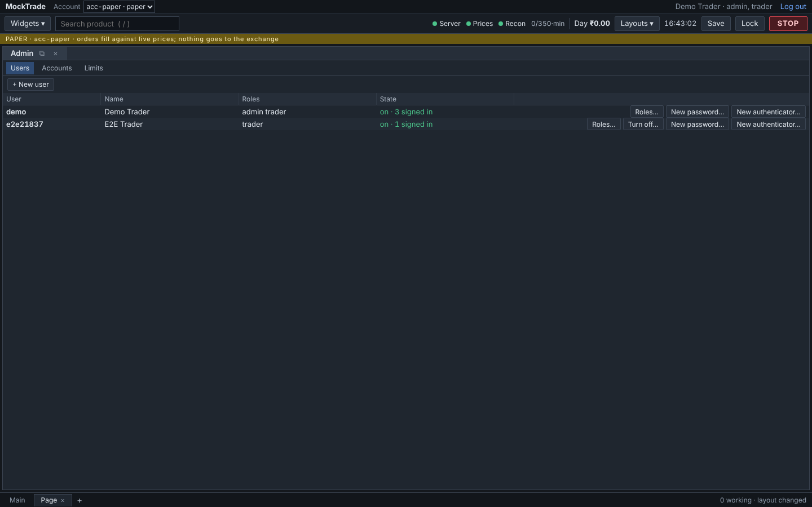

# Admin: users, roles, accounts and limits (K13)

## K13.1 The admin API (#281)

Before K13, users and accounts were added from the server's terminal (`tools/users.py`, which still works), and each account's risk limits were fixed when the server started. Now an admin does all of it from the API, and the K13.2 screen will draw itself from what the server publishes.

```
admin's screen ──PUT /api/admin/accounts/acc-1/limits──▶ check against the limits spec
                                                          │ refused? 422 with every reason
                                                          ▼
                                    changes (looser/tighter) + warnings for what is open
                                                          │ dry_run? stop here (a preview)
                                                          ▼
                       saved (users.db: account_limits) ──▶ AccountRuntime.apply_limits
                       audited ADMIN_LIMITS_CHANGED         risk checks · daily-loss stop ·
                                                            MTM and square-off closing pieces
```

### Who may do what
- **Admin:** everything below.
- **Risk:** reads users, accounts and limits. Can't change anything.
- **Others:** 403.
- Changing requests pass the same origin and JSON checks as every other request.

### Users (`/api/admin/users…`)
- **Create.** The server makes a one-time password and an authenticator link, each shown once.
  - The new user must set their own password before anything else.
  - Until then every route except `/api/me`, `/api/me/password` and logout answers 403, and the stream is refused.
- **Change:** name, roles, on/off. Turning a user off logs them out everywhere at once.
- **Unlock** after failed logins.
- **Reset the password:** a one-time password again, and the user is logged out.
- **Reset the authenticator** (a lost phone): the old codes stop working.
- **Guards, kept on the server:**
  - There is always an active admin. The last one can't lose the role or be turned off. This is checked under the store's lock, so two admins can't remove each other at the same moment.
  - An admin can't turn themselves off.
- **Every user's own change:** `POST /api/me/password` needs the old password, a new one of 12 or more characters, and different from the old. It ends that user's other sessions.

### Accounts (`/api/admin/accounts…`)
- **Create.** The server says which brokers it can run (`brokers`). A paper account runs at once:
  - `Platform` starts its loops even though `run()` is already going, and ends them with its own.
  - A Kite account starts after a restart, because its app key must be in the settings first. The listing says why an account isn't running.
- **Who else may trade it.** They must be users. The owner always may, so the owner isn't listed.
- **Turn it off or on:**
  - A turned-off account takes **only closing trades**. The risk gate checks every new order from any source (ticket, algo, GTT leg, basket): an order passes only if it reduces the position, counting what already works on that side.
  - Cancels always work.
  - Its traders still see it and can stop it, close it and cancel on it (`can_manage`). `/api/me` sends `active: false` so the screen can say so.

### Limits (`/api/admin/limits/spec`, `/api/admin/accounts/{id}/limits`)
- **The spec.** `risk/limits_spec.py` publishes every `RiskLimits` field in the algo-spec format: label, kind, range, default and help.
  - New kinds: `money` (paise, shown in rupees), `choices` (several of a list) and `instruments` (a list of contracts).
  - The price band has one field per kind: `price_band_pct.EQ`, `…FUT`, `…CE`, `…PE`.
  - A test makes sure no limit is ever missing from the spec.
- **PUT** checks everything the same way:
  - unknown names, kinds and ranges;
  - at least one exchange and one kind;
  - blocked contracts must exist.
- **The answer:**
  - `changes`: each changed limit with the old and new value in words, and whether the change **loosens** it. The screen asks twice before a loosening.
  - `warnings`: what a tighter limit means for what is open now. Examples: a position above the new position limit takes only reducing orders; too many working orders blocks new ones until some finish; a loss already beyond a new daily-loss limit stops trading at the next price change. **An edit never cancels or closes anything itself.**
  - `?dry_run=true` is a preview: nothing is saved or applied.
- **Applied from the next order** everywhere a limit had been copied at the start: the risk gate, the daily-loss stop, and the closing pieces of the MTM watch and the square-off. Working orders are left as they are.
- **Saved** in `users.db` (`account_limits`), so they come back after a restart (`serve`, `demo`).
  - A saved name a newer version no longer knows is dropped.
  - A value now out of range takes its default.
  - So a saved file never stops an account from starting (`stored_limits`).

### Audit
Every change is written with who made it and the before and after values:
- `ADMIN_USER_CREATED`, `ADMIN_USER_CHANGED`, `ADMIN_USER_UNLOCKED`;
- `ADMIN_PASSWORD_RESET`, `ADMIN_AUTHENTICATOR_RESET`, `PASSWORD_CHANGED`;
- `ADMIN_ACCOUNT_CREATED`, `ADMIN_ACCOUNT_CHANGED`;
- `ADMIN_LIMITS_CHANGED`.

Passwords and authenticator secrets are never written.

### Older files
An older `users.db` gets the new column (`must_change`) and table when the server opens it.

### Checks
- `tests/test_admin.py`:
  - the spec covers every limit and its defaults;
  - every kind of refusal;
  - saved limits from another version;
  - looser or tighter for each kind of limit, both ways;
  - the warnings, including values exactly at a limit;
  - a turned-off account (closing passes, flipping the position doesn't);
  - limits reaching everything that copied one;
  - a late account's loops starting and stopping with the platform;
  - the last-admin guard; turning off, unlocking and resetting;
  - account changes; an older users file;
  - the whole API, including a new user's first login and password change, and the stream refused before it.
- `context/scripts/mutate-admin.py`: 41/41 caught. Two mutants of the looser test are left out because they are equivalent: a change only ever holds values that differ. The first run found 5 real gaps, and each now has a test.
- `context/scripts/check-admin.py` on the demo, and again after a restart (`--after-restart`):
  - a new user logged in with the one-time password, was refused (403) until they set their own, then worked;
  - their new paper account ran at once and took an order;
  - after the preview and then the real change of the per-order limit to 1 lot, a 2-lot order was refused;
  - the turned-off account refused an opening order and cancelled a working one;
  - the demo admin couldn't turn itself off;
  - the audit rows were written;
  - after a restart, the account ran with its saved limit.


## K13.2 The admin screen (#282)



**Who sees it.** The **Admin** widget is offered in Widgets ▾ only to admins and risk users (`roles` on a widget's registration; the server checks every call anyway).
- Risk users get it read only: no buttons, and the limit fields are disabled.
- Anyone else who opens a saved layout containing it sees "For admin and risk users", and nothing is asked of the server.

**Users tab:**
- The list shows each user's state in words: on, signed in on N browsers, locked by failed logins, must set a password, off.
- New user, Roles…, Turn off…, Unlock, New password… and New authenticator… are available. The role names and what each allows come from `GET /api/admin/roles`.
- A new user's one-time password and authenticator are shown **once**:
  - the password;
  - the key in groups of four, for typing in by hand;
  - a **QR code** to scan (`components/QrCode.tsx`, drawn as an SVG from `qrcode-generator`, MIT, no dependencies).
- "Done: I've handed these over" removes them for good.
- You can't turn yourself off; the server refuses it too.

**Accounts tab:**
- The list shows each account's state: running, not running and why, or off (closing trades only).
- New account offers only the brokers this server can run.
- Traders…, Turn off… and a Limits button that opens the Limits tab on that account.

**Limits tab** 
- The form is drawn **entirely from the limits spec**; nothing in the screen names a limit:
  - money as rupees with Indian grouping, sent as paise (never through floats);
  - lots and counts as whole numbers;
  - percent and seconds as decimals;
  - flags as tick boxes;
  - `choices` as a tick box per choice;
  - `instruments` as a list with search.
- The price bands sit together.
- Problems are said before anything is sent, then the server checks again.
- **Check changes** asks the server for a preview (`?dry_run=true`): what changes, each marked looser or not, and the warnings for what is open now.
- **Save** sends exactly what was checked. Editing after a check removes the preview, so a new check is needed.
- A change marked **looser** takes a second click ("Confirm: loosen and save").

**Second clicks** also guard: turning a user or an account off, a new password, and a new authenticator.

**First sign-in.** A user with a one-time password sees only **Set your password**:
- They enter the one-time password, then the new one twice. The two must match, and the rules are the server's (its answer is shown as given).
- The live stream doesn't start until then, because the server would refuse it.
- After the change, the terminal opens. They can also sign out instead.

**Any size.** Every widget works at any size, so Admin adapts to its own width (a CSS container query): in a narrow pane each user or account becomes a short block with its buttons underneath, and the widget scrolls.

**Checks:**
- UI tests: `widgets/admin` (model and widget), `shell/SetPassword.test.tsx`, `workspace/registry.test.ts`.
- `context/scripts/mutate-admin-ui.py`: 32/32 caught. The first run's one survivor, the password match on Enter, now has a test.
- `context/scripts/e2e-admin.cjs` on the demo in a real browser:
  - the admin adds a user; the one-time password, key and QR code are shown once, then gone;
  - the user signs in elsewhere and sees only Set your password; a short password gets the server's words; their own opens the terminal, without the Admin widget;
  - the admin tightens the per-order limit to 1 lot (check, then save), and a 2-lot order is refused; the loosening back takes two clicks;
  - no page errors.

## Who sees what (#270)

| Resource | Whose | Who sees it |
| --- | --- | --- |
| An account's orders, positions, algos, GTTs, charges, MTM, its **alert bands** (Kite login, UNPROTECTED, MTM, square-off, failed restart) | the account | its owner and traders; risk and admin. Re-checked while connected: access taken away stops the stream at once. |
| Firm-wide alert bands (prices, disk, audit log, price overload) | the firm | everyone signed in (they affect every account) |
| Price alerts and their webhook | the user | that user only |
| Backtests | whoever started one | that user; admins see all. Someone else's answers **"no backtest …"**, exactly like one that doesn't exist. Runs kept from before #270 have no owner: admins only. |
| Recorded ticks (market data, no account data) | shared | everyone signed in can read; admins delete |
| Imported candles (one dataset every backtest reads) | shared | admins import; everyone's backtests read |
| `/api/ops` (every alert, every job) | the firm | risk and admin |

## Taking someone's rights away: what happens to what they left running (#366)

Removing a trader from an account, disabling a user or taking the trader role away is checked
again **when each action actually happens**, not only when it was asked. Nothing to restart.

| What they left behind | What happens at once |
| --- | --- |
| A new order or a change that adds risk | refused, saying why ("ravi may no longer trade acc-1") |
| A closing order (reduce-only, the exit desk), a cancel | still goes: getting out is never blocked |
| A running algo | stops before its next child order, with the reason on the algo screen; its working children are pulled like any stopped algo. A hedge leg is held, as under STOP: the account's other traders or risk close what is left (Flatten) |
| A GTT that could open a position | deleted at the broker on the next poll (a few seconds), saying why; one that fires anyway has its order cancelled |
| A GTT that only reduces (a stop-loss, a target) | kept: it still protects the position |

Turning an **account** off is different: everyone keeps closing rights and the risk gate lets
only closing trades through, exactly as on the screens. Code: `risk/access.py`.
