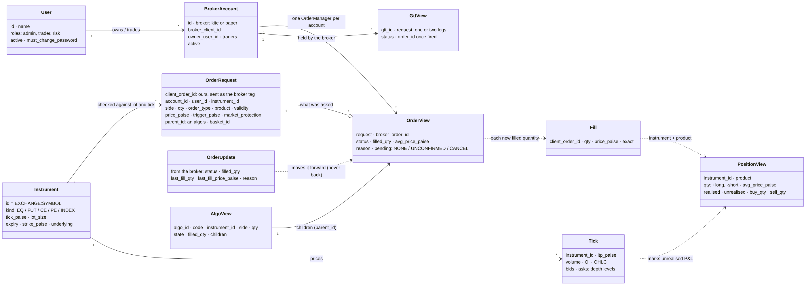

# Domain model

The things MockTrade works with and how they relate. The types live in `src/mocktrade/domain/`, plus the order manager's views (`orders/model.py`), positions (`positions/book.py`) and algos (`algos/engine.py`). Words are explained in the [glossary](glossary.md).

Source: `context/images/v1-domain-model.mmd`. Render it with `context/scripts/render-mermaid.cjs`.

## The main types

| Type | Where | What it is | Key fields |
|---|---|---|---|
| `User` | `domain/accounts.py` | A person who logs in | `id`, `name`, `roles` (admin, trader, risk), `active`, `must_change_password` |
| `BrokerAccount` | `domain/accounts.py` | One account at one broker | `id`, `broker` (`kite`, `paper`), `broker_client_id`, `owner_user_id`, `traders` (others allowed), `active` |
| `Instrument` | `domain/instruments.py` | Something with a price | `exchange`, `symbol` (id = `EXCHANGE:SYMBOL`), `kind`, `tick_paise`, `lot_size`, `expiry`, `strike_paise`, `underlying`, `freeze_qty` (the exchange's most per order, #424; from `MOCKTRADE_FREEZE_FILE`) |
| `Tick` | `domain/ticks.py` | One price update | `instrument_id`, `ltp_paise`, volume, OI, OHLC, `bids`/`asks` (`DepthLevel`: price, qty, orders) |
| `OrderRequest` | `domain/orders.py` | What someone asked for | `client_order_id`, `account_id`, `user_id`, `instrument_id`, `side`, `qty`, `order_type`, `product`, `validity`, `price_paise`, `trigger_paise`, `market_protection`, `parent_id` (an algo's), `basket_id` |
| `OrderUpdate` | `domain/orders.py` | What the broker says now | `status`, `filled_qty`, `avg_price_paise`, `last_fill_qty`, `last_fill_price_paise`, `reason` |
| `OrderView` | `orders/model.py` | An order as the screens see it | `request` (current values after modifies), `broker_order_id`, `status`, `filled_qty`, `avg_price_paise`, `reason`, `pending` |
| `Fill` | `orders/model.py` | New quantity traded on one order | `client_order_id`, `qty`, `price_paise`, `exact` |
| `PositionView` | `positions/book.py` | What is held in one instrument and product | `qty` (+/−), `avg_price_paise` (exact fraction), `ltp_paise`, `realised_paise`, `unrealised_paise`, today's buy/sell totals |
| `GttView` | `domain/gtt.py` | A trigger order held by the broker | `gtt_id`, `request` (one or two legs), `status`, `order_id` once fired |
| `AlgoView` | `algos/engine.py` | A parent order worked by an algo | `algo_id`, `code`, `instrument_id`, `side`, `qty`, `state`, `filled_qty`, `children` |
| `OrderSpec` | `domain/order_spec.py` | What an instrument allows | order types with their needs, products, tick, lot, max modifications |
| `Trade`, `Holding`, `Funds` | `domain/portfolio.py` | The broker's own tradebook, holdings and funds | as the broker reports them |

## Rules the types keep

- **All money is whole paise** (`int`), and an average price is an exact `Fraction`. Nothing is a float, so totals add up exactly.
- **Our ids, never a broker's.** Instruments are `EXCHANGE:SYMBOL`. A broker's own number (Kite's instrument token) lives only in the instrument store's mapping, so another broker could be added behind the same interface.
- **One order manager per broker account.** Accounts never share order state, so they could later run in separate processes.
- **What was asked is kept apart from what is known.** `OrderRequest` is what was asked (updated by modifies); `OrderView` adds what the broker said.
- **Positions come only from fills.** A fill carries just the new quantity, and an order's filled quantity never shrinks, so a repeated update can't count a fill twice.
- **Instruments are checked before anything is sent.** An order whose quantity isn't a whole number of lots, or whose price is off the tick grid, is refused before it reaches a broker.
