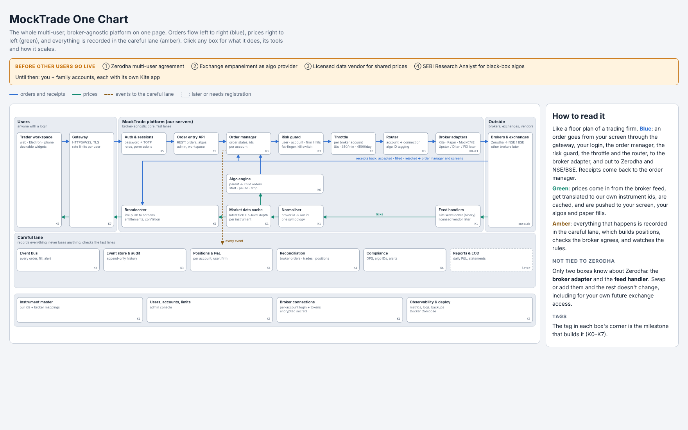
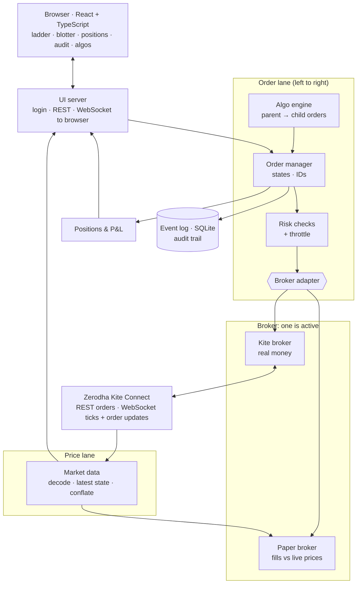
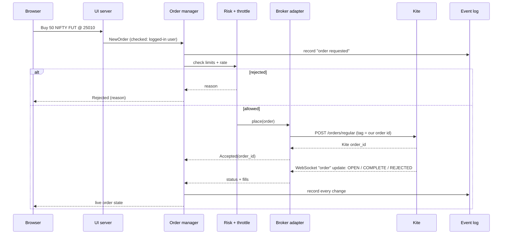
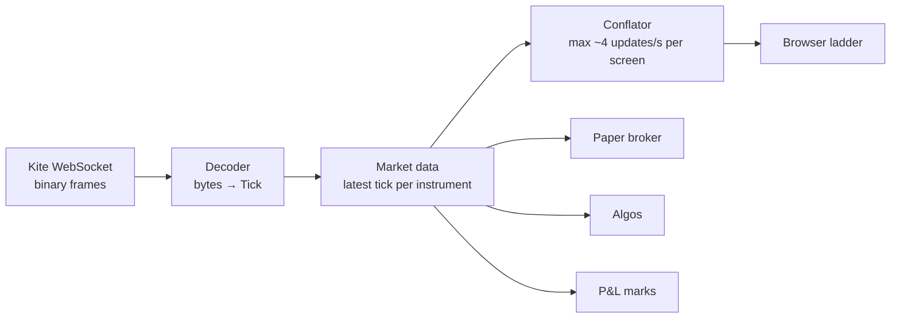
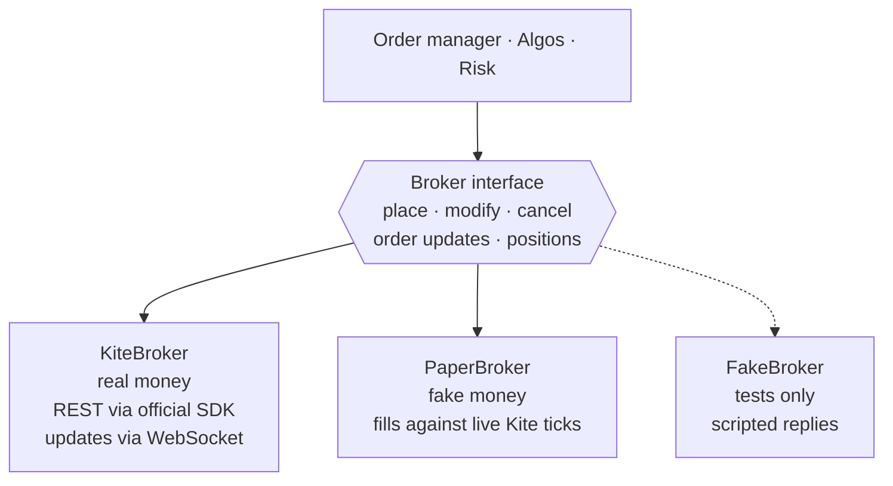
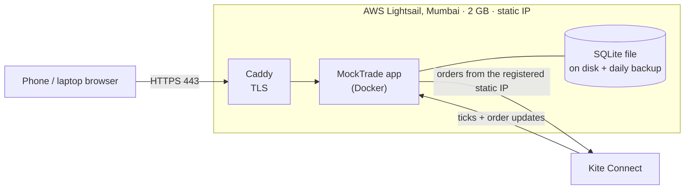

# MockTrade on Kite Connect: architecture

**Status:** accepted (14 Oct 2026), **extended the same day to multi-user and broker-agnostic** (§0). Replaces the COMEX/MockCME plan for MockTrade. MockCME is paused, not deleted.
**Facts checked on:** 14 Oct 2026 (sources at the end). Kite's limits change, so re-check them before going live.

MockTrade is a personal, professional-style trading platform for NSE and BSE. It has a price ladder, an order blotter, positions and P&L, an audit trail, and parent/child algo order management. It connects to the real market through Zerodha's **Kite Connect** API. A **paper broker** fills orders against live Kite prices, so everything can be tested without real money.

---


## 0. Multi-user and broker-agnostic (decided 14 Oct 2026)

MockTrade is a **multi-user platform**. Each user logs in with their own credentials and 2FA, and links **their own broker account** through the broker's own login page. The **only** limits the platform has are the broker's and the exchange's. **Zerodha is one adapter, not the foundation:** other brokers, or direct exchange access later, plug in behind the same interfaces.



*The interactive version is `context/one-chart/one-chart.html`: open it in a browser and click any box.*

**What changes because of multi-user:**

| Area | Single-user design | Multi-user design |
| --- | --- | --- |
| Identity | One login | `User` with roles (admin, trader, risk); password + TOTP |
| Broker | One Kite session | `BrokerAccount` per linked account; each has its own adapter instance, session token (encrypted), throttle and feed |
| Risk | One set of limits | Limits at **user**, **account** and **firm** level; kill switch at each level |
| Instruments | Kite tokens everywhere | **Our own instrument ids** (`NSE:RELIANCE`, `NFO:NIFTY26OCTFUT`); each broker's numbers live in a mapping table |
| Market data | One feed | Feeds belong to an account; **entitlements** decide who may see which feed |
| Storage | SQLite file | **PostgreSQL** in production (SQLite stays for tests and laptop dev), behind the same repository code |
| Scaling | One process | Order managers are **sharded by broker account**, so each account lives in exactly one place and needs no locks |

**Go-live gates for other users (researched 14 Oct 2026):**
1. **Zerodha multi-user arrangement.** A retail Kite Connect app is bound to one client id; for multi-user platforms Zerodha asks you to email them with your platform's details.
2. **Exchange empanelment as an algo provider.** Under SEBI's framework, platforms that serve other users are algo providers: empanelled with the exchanges, onboarded by the broker (the broker is the principal), and every algo order carries an exchange-issued ID.
3. **Licensed market data.** Kite data can't be displayed to other users. Shared prices need an exchange-authorised data vendor, which plugs in as another feed handler.
4. **Research Analyst registration** for any black-box algo (logic not disclosed) offered to others.

Until these are done, MockTrade runs for **you and family accounts** (Zerodha allows family members under one developer profile, each with a separate API key), with each account using its own Kite app and its own feed.

Sources for §0: https://kite.trade/forum/discussion/3935/can-multiple-users-use-one-kite-connect-app · https://kite.trade/forum/discussion/15842/how-do-i-provide-access-to-multiple-users-to-kite-connect-api-via-my-app · https://support.zerodha.com/category/trading-and-markets/general-kite/kite-api/articles/can-i-use-historical-and-live-data-taken-from-kite-connect-api-on-other-platforms · https://www.quantinsti.com/articles/algorithmic-trading-india/ · https://inthemoneybyzerodha.substack.com/p/sebi-algo-trading-changes-april-2026

---

## 1. Words you need first

| Word | Plain meaning |
| --- | --- |
| **Exchange** | Where orders actually match: NSE or BSE. |
| **Broker** | The company that sends your orders to the exchange for you (Zerodha). You can't talk to NSE directly. |
| **API** | A door a program can knock on. Kite Connect is Zerodha's door for programs. |
| **REST** | One kind of API: you send one request and get one reply, like posting a letter and getting an answer. Used for orders. |
| **WebSocket** | A connection that stays open, so the server can push messages to you anytime, like a phone call left on. Used for live prices. |
| **Tick** | One price update for one instrument. |
| **LTP** | Last traded price. |
| **Depth** | The best 5 buy prices and best 5 sell prices waiting at the exchange, with quantities. Kite gives 5 levels. |
| **Instrument token** | Kite's number for an instrument (e.g. one stock or one futures contract). |
| **Rate limit** | The most requests allowed per second or minute. Go over it and requests are refused (HTTP 429). |
| **Latency** | Delay between something happening and you seeing or acting on it. |
| **Static IP** | A fixed internet address for a server. Kite only accepts orders from the address you register. |
| **OPS** | Orders per second. |
| **Adapter** | A plug converter. Our code talks to one shape of "broker", and an adapter converts that to Kite or to the paper simulator. |
| **Paper trading** | Pretend trading: real prices, fake money. |
| **Process** | One running program. |
| **Event loop (asyncio)** | Python's way of juggling many waiting tasks (network, timers) in one process without threads. |
| **Database** | A file or server that stores data safely so it survives restarts. We start with SQLite, which is just a file. |

---

## 2. What Kite gives us, and its limits

These numbers decide the whole design. Each one came from Kite's docs or Zerodha staff (links at the end).

| Limit | Value | What it means for us |
| --- | --- | --- |
| Price for live + historical data | **₹500 per month** per app (order APIs alone are free) | Needed: no data means no ladder. Fits the ₹500–800 budget. |
| Tick rate | About **1 tick per second per instrument**, sometimes 2 for very liquid ones; sent when a trade or the depth changes | Prices are *snapshots*, not every trade. Our side can be "slow" (milliseconds) and still be 100× faster than the data. |
| Depth | **5 bid + 5 ask levels** in `full` mode (184-byte packet) | The ladder shows 5 real levels, not a full book. Be honest about that in the UI. |
| WebSocket capacity | **3000 instruments per connection, 3 connections per API key** | Up to 9000 instruments. We'll use far fewer. |
| Order placement | **10 per second, 400 per minute, 5000 per day** per user (across all apps) | Our throttle stays *below* these, so Kite never has to refuse us. |
| Modifications | **25 per order**, then cancel and place again | Algos must count modifications per order. |
| Quote API | **1 request per second** (up to 500 instruments per call) | Never poll prices. Use the WebSocket. |
| Other REST endpoints | 10 per second | Order book, positions and similar: fetch on demand, not in tight loops. |
| Login | Manual login gives an `access_token` that **expires at 6 AM the next day** | Log in once each trading morning. No automated password/TOTP login (it must be the user). |
| Static IP | **Order endpoints** only accept requests from the registered IP (1 primary + 1 backup) | Real orders must come from the cloud server, never the laptop. Data works from anywhere. |
| Market orders | Must carry `market_protection` (−1 = automatic, or 1–100 %); **0 is rejected** | Our order model makes this field required for MARKET and SL-M orders. |
| SEBI algo rule | Up to **10 orders/second per exchange segment** without exchange registration; above that the strategy must be registered | We cap ourselves well under 10 OPS. Personal use only. |
| "No open APIs" | Broker APIs mustn't be exposed for others to use | Our server requires login. It's for one user, and never offers trading to anyone else. |
| Order updates | Pushed as JSON `order` messages on the same WebSocket, for all your orders | We use these instead of postbacks (postbacks need a public HTTPS URL and only cover this app's orders). |
| Instrument list | A CSV dump generated **once a day**; fetch it around 08:30 | A morning job loads it into our database. |

**Honest consequences:**
- This isn't co-located, microsecond trading. Kite adds network and broker time we can't control. Our job is to add **almost nothing** on top and to **never break a rule**.
- The ladder shows 5 levels updated about once a second, and the UI says so.
- Using it for other people's accounts would make us an "algo provider" needing exchange registration. MockTrade stays personal.

---

## 3. The big picture



Read it as two lanes:
- **Prices flow right to left:** NSE/BSE → Kite WebSocket → market data → your screen, the paper broker, the algos and the P&L.
- **Orders flow left to right:** screen or algo → order manager → risk + throttle → broker adapter → Kite REST → exchange. The receipts come back on the WebSocket.

Everything runs in **one Python process** at first, called a "modular monolith": one program, but with separate modules that only talk through clear interfaces. It's the simplest thing that meets the numbers (see §6), and each module can become its own process later without being rewritten.

### How the reference platform maps to MockTrade

| Professional platform part | MockTrade module |
| --- | --- |
| Screens: ladder, order book, positions, audit | `ui/` (React) |
| Hub / app server: logins, routing screens to services | `server` |
| Market data service: book per instrument, fan-out | `marketdata` |
| Guard / risk + order manager: checks every order, tracks its life | `orders` + `risk` |
| Runner / exchange gateway: speaks the venue's language | `broker` (Kite adapter) |
| Simulator for practice | `broker` (paper adapter) |
| Algo servers: parent/child orders, start/stop | `algos` |
| Accounts office: fills → positions → P&L | `positions` |
| Careful lane: everything recorded, nothing lost | `store` (event log) |
| Reference data | `refdata` |

---

## 4. The two lanes in detail

### 4.1 An order's journey



- **Our order id** goes into Kite's `tag` field (max 20 characters). When an update arrives, we know exactly which of our orders it belongs to.
- Every step is written to the **event log** before anything else depends on it. That makes up the audit trail.
- On reconnect (after a network blip), the order manager calls `GET /orders` and **reconciles**: it compares Kite's view with ours and fixes any differences. No order is ever "lost".
- **Positions are kept, compared and closed per instrument *and* product** (MIS, NRML, CNC), as Kite lists them (#258). The same contract can be long in one product and short in another. Comparing per instrument let one of Kite's rows overwrite the other: a false difference, or a hidden one.
  - The position check (every few minutes) and the rebuild after a restart compare each product on its own. Only where the broker doesn't say a row's product is that contract compared on its net.
  - The paper broker lists one row per product, like Kite.
  - "Only closing trades" (past the daily loss limit, or on a turned-off account) means closing *that product's* position: a MIS sell doesn't close an NRML long, because at the broker it opens a MIS short.
  - Exposure limits still count the net across products.
  - Alerts name the product, and the Positions screen marks only that row.

### 4.2 A price's journey



- **The decoder** turns Kite's binary packets into `Tick` objects. Prices arrive as whole **paise** (integers), and we keep them that way: same lesson as ticks in MockCME, never floats.
- **Market data** keeps only the *latest* state per instrument. Old ticks are overwritten, not queued.
- **The conflator** protects slow screens: if 3 ticks arrive within 250 ms, the browser gets one update with the newest state.

---

## 5. The broker adapter boundary

Everything above this line knows nothing about Kite:



**The interface (one Python `Protocol`):**

| Method | Meaning |
| --- | --- |
| `place(request) -> broker_order_id` | Send a new order |
| `modify(order_id, price, qty)` | Change a working order |
| `cancel(order_id)` | Cancel a working order |
| `updates()` | A stream of `OrderUpdate` events (accepted, partial fill, filled, cancelled, rejected) |
| `orders()` / `positions()` | The broker's view, used for reconciliation |

**PaperBroker fill rules.** It's conservative on purpose, so paper results don't flatter you:
1. **Marketable order** (buy at or above the best ask): fills now, walking the 5 depth levels, at each level's price, up to the quantity shown. Anything left rests (or is cancelled if IOC).
2. **Resting order:** it remembers the quantity **ahead of it** at its price, taken from depth when placed. Volume traded at our price uses up the queue ahead first. When the price trades **through** our level, we fill completely.
3. **Market orders** are treated as limit orders at LTP ± `market_protection` %, like the real rule.
4. **Simulated latency** (e.g. 80 ms, adjustable) before each acknowledgement, so algos are tested against real-world delays.
5. It applies the **same throttle and validation** as Kite (tick size, lot size), so a strategy that passes on paper won't hit new errors on Kite.

Switching between real and paper is **one setting**. The rest of the program can't tell the difference, which is what makes paper testing trustworthy.

---

## 6. Languages and tools: measure first

| Part | Choice | Why (with numbers) |
| --- | --- | --- |
| Server, all modules | **Python 3.12 + asyncio** | Load estimate: 500 instruments × ~1.5 ticks/s ≈ 750 ticks/s × 184 bytes ≈ 140 KB/s. Decoding a packet with `struct` takes a few microseconds, which comes to well under 5 % of one CPU. Orders: at most 10/s. Python has 100× headroom, so a faster language would buy nothing visible. **We measure this in issue K7.3** before believing it. |
| Kite REST calls | **Our own small async client** (httpx) | *Changed while coding (14 Oct):* the SDK is synchronous and drags in Twisted; Kite's REST API is simple form-encoded HTTP with JSON replies. The official SDK (v5.2.2) stays in the test suite as a reference implementation. |
| Kite WebSocket | **Our own asyncio client** (`websockets` library) + our own binary decoder | The SDK's ticker uses Twisted, a second event-loop system that fights asyncio. Our decoder is about 60 lines, and tests check it gives **the same answers as the SDK's parser** on the same bytes. |
| Web server | **FastAPI + Uvicorn** | Async, typed, WebSocket support, automatic API docs. |
| Database | **PostgreSQL** in production, **SQLite** for tests and laptop dev, through **SQLAlchemy 2** (async) | Multi-user data (users, accounts, limits, events) is relational and needs safe concurrent writers. *Changed while coding (14 Oct):* for now Python's built-in **sqlite3** (WAL, one writer thread) with no ORM; PostgreSQL later is one new class behind the same interface. |
| UI | **TypeScript + React + Vite**, built as **widgets** in a dockable workspace (**dockview**) | Professional trading front ends are workspaces of small windows (ladder, blotter, positions, algos) that traders arrange and save. React components map one-to-one to widgets. |
| Desktop app | **Electron** shell around the same UI (later) | Desktop trading apps commonly use Electron: real OS windows that can be popped out onto other monitors, plus keyboard shortcuts. The same code also runs in a phone browser. **Tauri** is the lighter alternative (Rust shell, smaller memory); we can measure both. |
| Packaging | **Docker Compose** | The same setup on the laptop and the server. |
| HTTPS | **Caddy** | Gets and renews TLS certificates automatically, with no manual setup. |
| Login security | Password + **TOTP** (`pyotp`) | Our server can place real orders, so it needs two locks. |
| Event bus | In-process asyncio pub/sub first, **Redis Streams** when split into processes | Same interface either way, so the switch is configuration. |
| Monitoring | JSON logs, `/health`, latency histograms at `/metrics` | Enough for one server. Grafana later, if needed. |

**When would we switch language?** Only if a measurement shows a part using a large share of the CPU or adding noticeable delay. The plan then: (1) profile, (2) fix the algorithm, (3) try `orjson`/`uvloop`, (4) rewrite just that function in **Rust** as a Python extension (PyO3). We wouldn't rewrite the whole program.

### Screens: widgets first, desktop app later

```
┌──────────────────────── MockTrade workspace ────────────────────────┐
│ ┌── Ladder: NIFTY FUT ─┐ ┌── Order ticket ──┐ ┌── Positions ───────┐ │
│ │ bid │ price │ ask    │ │ BUY / SELL       │ │ symbol  qty  P&L   │ │
│ │     │ 25012 │ 150    │ │ qty  price       │ │ ...                │ │
│ │ 75  │ 25010 │        │ └──────────────────┘ └────────────────────┘ │
│ └──────────────────────┘ ┌── Blotter ─────────────────┐ ┌── Algos ─┐ │
│                          │ id  side qty price status  │ │ slicer ▶ │ │
│                          └────────────────────────────┘ └──────────┘ │
└──────────────── drag, dock, resize, save layout, pop out ────────────┘
```

- **Every screen is a widget:** a React component that takes the instrument or filter it shows as input and talks to the server only through the shared WebSocket client. No widget knows about any other.
- **Workspace:** widgets dock, tab, resize and are saved as a named layout, restored at login.
- **Forms** (order ticket, algo parameters, risk limits) are typed, with validation shared in spirit with the server's rules (tick size, lot size, market_protection), so mistakes are caught before the click.
- **Phase 1:** a web app (works on the laptop and phone). **Phase 2:** an Electron shell for real pop-out windows on multiple monitors. The widget code doesn't change.

### Latency budget (our side only)

| Step | Target | Note |
| --- | --- | --- |
| Tick bytes → decoded `Tick` | < 50 µs | **Measured: ~17 µs** per full packet (benchmark test) |
| Tick → browser update sent | < 20 ms | Including conflation wait: ≤ 250 ms by design |
| Click → order request leaves the server | < 5 ms | Risk + throttle + event log |
| Kite REST round trip | *measure* | Depends on Kite and the network, not us. Logged on every order. |

---

## 7. Deployment on one small server



- **Where:** Mumbai region, close to Zerodha's servers. **AWS Lightsail** 2 GB / 2 vCPU costs **$12/month** with a static IP included, so **$100 lasts about 8 months**. The 1 GB plan ($7) also works for the first months, at about 14 months for $100.
- **Static IP:** attach Lightsail's static IP, then register it in the Kite developer console under **IP Whitelist**.
- **Monthly cost:** about $12 server + ₹500 Kite data.
- **Daily routine:**
  1. 08:30: the instrument list loads automatically.
  2. 09:00: you open MockTrade on your phone and tap **Log in with Kite** (the manual Zerodha login + 2FA), which gives a new token.
  3. 09:15: the market opens.
  4. Next 06:00: the token expires.
- **Safety:** only ports 443 (and 22 for SSH with keys) are open. Secrets live in an `.env` file on the server, never in git.

### Path to scale later

| Stage | When | Change |
| --- | --- | --- |
| 1 | Now | One process, SQLite, one server |
| 2 | Measured CPU or reliability need | Split market data and order manager into separate processes, linked by **Redis Streams** or **NATS**; SQLite → PostgreSQL |
| 3 | More brokers | Add adapters (Upstox, Dhan, Angel) behind the same interface |
| 4 | A hot function measured too slow | Rewrite only that function in Rust (PyO3) |

---

## 8. Code layout

```
src/mocktrade/
  domain/        types: Instrument, OrderRequest, Order, Tick, Fill, events (money in paise)
  refdata/       instrument list loader
  marketdata/    decoder, WebSocket client, latest state, conflation
  broker/        base.py (interface), kite.py, paper.py, fake.py
  orders/        order manager + state machine
  risk/          pre-trade checks, throttle, kill switch
  positions/     positions and P&L
  store/         event log (SQLite)
  algos/         algo engine + strategies
  server/        FastAPI app, auth, browser WebSocket
ui/              React + TypeScript widgets + workspace (Electron shell later in ui/desktop/)
deploy/          Docker Compose, Caddy config, runbooks
tests/           one test file per module
```

---

## Sources (checked 14 Oct 2026)

- Kite rate limits and order caps: https://kite.trade/docs/connect/v3/exceptions/
- WebSocket limits, modes, depth, binary format: https://kite.trade/docs/connect/v3/websocket/
- Tick frequency (Zerodha staff): https://kite.trade/forum/discussion/comment/43580/ and https://kite.trade/forum/discussion/comment/4872/
- Login and token expiry: https://kite.trade/docs/connect/v3/user/
- Orders, `market_protection`, `tag`: https://kite.trade/docs/connect/v3/orders/
- Quote limits and instrument dump: https://kite.trade/docs/connect/v3/market-quotes/
- Postbacks: https://kite.trade/docs/connect/v3/postbacks/
- Pricing: https://support.zerodha.com/category/trading-and-markets/general-kite/kite-api/articles/what-are-the-charges-for-kite-apis
- Static IP and market protection (Zerodha staff): https://kite.trade/forum/discussion/comment/52291 and https://kite.trade/forum/discussion/comment/52145/
- SEBI/NSE retail algo framework: https://zerodha.com/z-connect/general/a-comprehensive-overview-of-nses-circular-on-the-new-retail-algo-trading-framework and https://inthemoneybyzerodha.substack.com/p/sebi-algo-trading-changes-april-2026
- SDK byte order (big-endian) and divisors: `kiteconnect` 5.2.2, `ticker.py`
- Lightsail pricing: https://aws.amazon.com/lightsail/pricing
