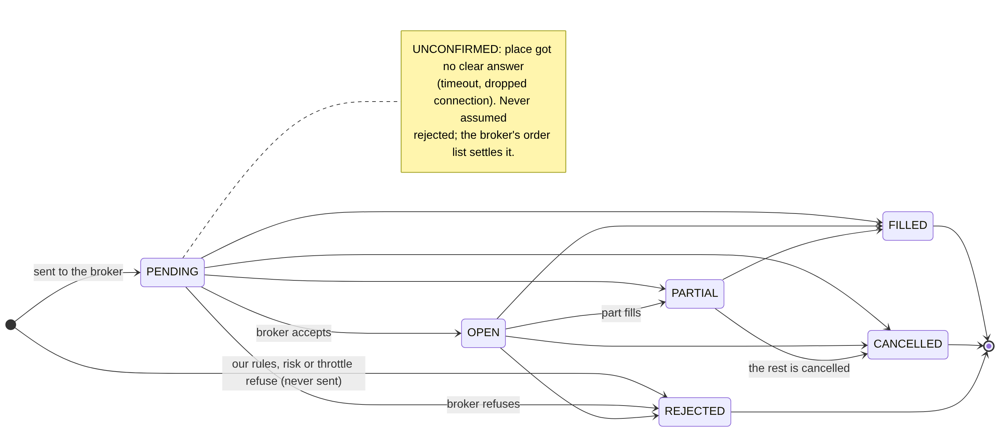
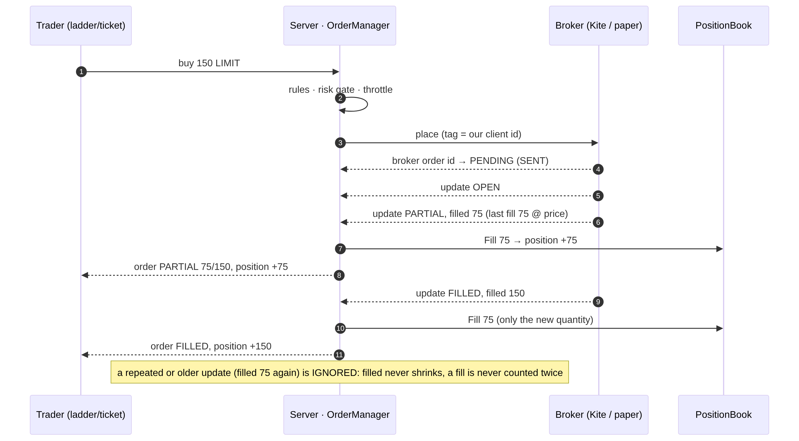
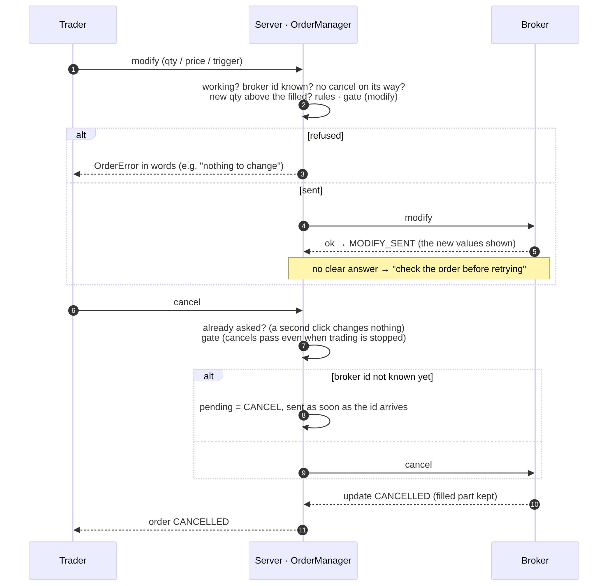
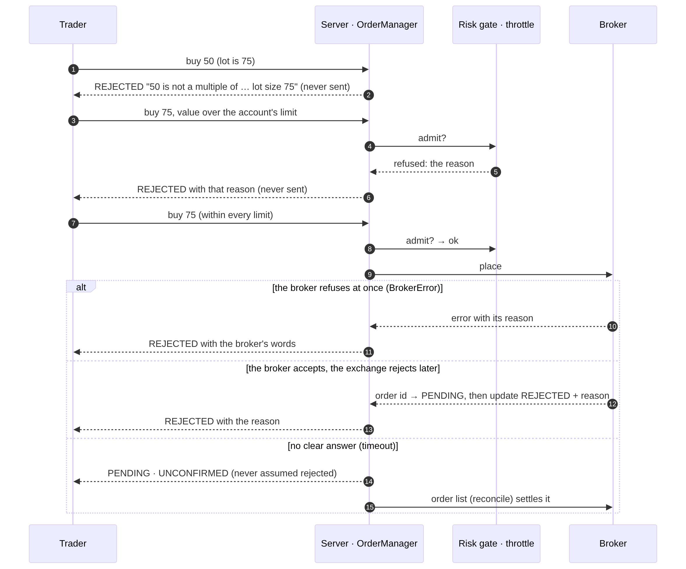
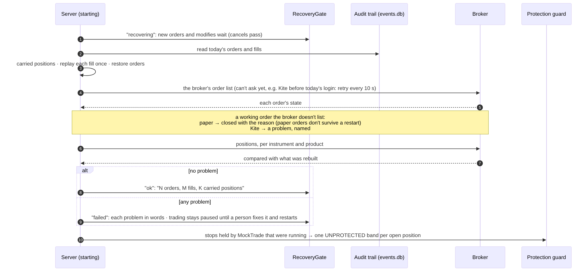
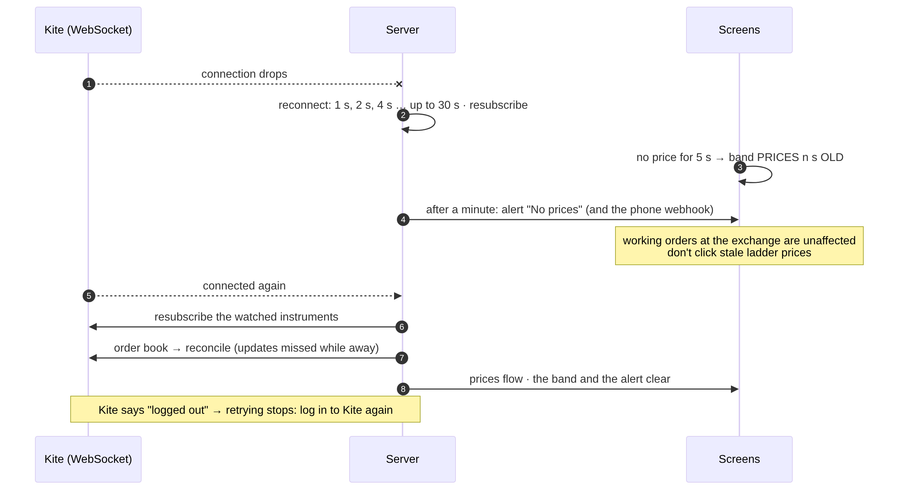
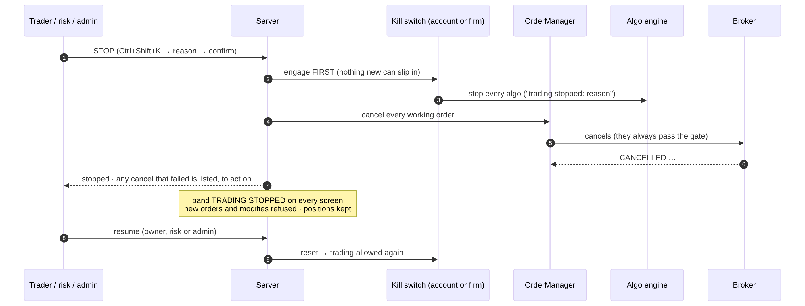

# An order's life, and the key journeys

How an order moves from a click to its end, and what happens in the moments that matter: a partial fill, a modify, a cancel, a reject, a restart, the broker disconnecting, and STOP. The code is `src/mocktrade/orders/manager.py`; the words are in the [glossary](glossary.md). The happy path (place and fill) is drawn in [kite-architecture.md](kite-architecture.md).

## States



An order's status **only moves forward**. The allowed moves are `ALLOWED` in `orders/manager.py`:

| From | Can move to | What the trader sees |
|---|---|---|
| (new) | REJECTED, never sent: refused by our rules (lot, tick, instrument, account), the risk gate or the throttle | REJECTED, with the reason |
| PENDING | OPEN, PARTIAL, FILLED, CANCELLED, REJECTED | sent; waiting for the broker to confirm |
| OPEN | PARTIAL, FILLED, CANCELLED, REJECTED | working at the exchange |
| PARTIAL | FILLED, CANCELLED | partly filled; the rest still works |
| FILLED, CANCELLED, REJECTED | nothing (final) | done; a cancelled order keeps what had filled |

Next to the status, `pending` says what we're waiting on:
- **NONE**: nothing.
- **UNCONFIRMED**: the place call got no clear answer (a timeout or a dropped connection). The order is never assumed rejected, and its risk stays counted. The broker's order list settles it (#259):
  - the manager asks the broker again by itself, at 2, 5, 10, 20, 30, 60 and 60 seconds, and after a restart too;
  - one list without the order proves nothing (a slow broker lists it late);
  - it becomes REJECTED only when **3 lists over at least 60 seconds** all miss it, and the reason says so ("not in its order list at 3 checks from … to …, 75 s after it was sent");
  - still unclear after every follow-up: it stays UNCONFIRMED and asks for a person. They check the broker's own order book, then press **Not placed?** in the order book, confirm, and the order is settled with their name;
  - placing is never retried blindly.
- **MODIFY**: a change is on its way (#260). Only one change at a time per order: a second one is refused in words, even while the first waits at the gate, so answers can never arrive out of order and undo a newer change. A cancel is still allowed, and wins.
  - **A change with no clear answer** may or may not have been made. Until the broker's own terms say (an update, or its order list, which the follow-up asks for), the order counts the **larger quantity** of the two, so risk is never understated. The audit trail shows **Replace unconfirmed**.
  - **Terms in updates:** broker updates now carry the order's terms (quantity, price, trigger). A streamed update older than our last confirmed change can't undo it. The broker's order list, fetched now, is the order as it is.
- **CANCEL with no clear answer** stays "cancel on its way": it may have gone through. The follow-up asks the broker. If its list still has the order working, the cancel didn't happen: the order goes back to working, and you can cancel again. Pressing cancel again is always allowed in this state.
- **CANCEL**: a cancel is on its way, or is waiting for the broker's id to arrive.

An update that would move an order backwards, or that repeats one already applied, is **IGNORED** and still recorded in the audit trail. An order we never placed (one made in Kite's own app) appears as **EXTERNAL**.

## Journeys

Each journey below has a diagram; the sources are `context/images/v1-journey-*.mmd`.

### Partial fill



Each broker update carries the order's total filled quantity. Only the new part becomes a `Fill`, so the position grows by exactly what traded, once.

### Modify and cancel



**A modify is refused, in words, when:**
- the broker hasn't acknowledged the order yet;
- a cancel is already on its way;
- nothing would change;
- the new quantity isn't above what has filled;
- it breaks the order rules or the gate.

**After the throttle makes an order wait for its turn**, the risk checks run again, so a limit tightened or a STOP pressed during the wait counts. **A cancel always passes the gate**, even while trading is stopped. A second click changes nothing. If the broker's id hasn't arrived yet, the cancel is remembered and sent as soon as it does.

### Rejects



Our rules, the risk gate and the throttle refuse an order **before it is sent**, saying why. A clear refusal from the broker also becomes REJECTED with the broker's words. One of our rules is the exchange's **freeze quantity** (#424): one order above it is refused, so algos, closes and the Autospreader split bigger quantities into orders that fit (`RiskGate.max_order_qty`), and the ticket says "max … per order". An exchange reject arrives later, as an update. A call with **no clear answer** is the dangerous case: it stays PENDING and UNCONFIRMED, never assumed rejected, until the broker's order list settles it.

### Restart with recovery



Until recovery says "ok", each account takes no new orders or modifies; cancels still pass. A problem keeps trading paused, named in words, until a person fixes it at the broker and restarts. Recovery is checked by `tests/test_recovery.py` and by the crash drill (`context/scripts/drill-restart.py`, 17/17). See also [incidents.md](../runbooks/incidents.md) § Trading paused after a restart.

### The broker disconnecting



Working orders at the exchange don't depend on our connection. While the connection is down, the screens say the prices are old. Once it is back, prices and order states are brought up to date from the broker's own order book. See [incidents.md](../runbooks/incidents.md) § WebSocket down.

### STOP



The switch is engaged **before** the cancels go out, so nothing new can slip in meanwhile. Positions are kept: STOP doesn't close them. Closing is a separate, deliberate action: **Flatten** in the red band (it works while trading stays stopped), square-off, MTM auto-close, or closing by hand after resuming. Only the account's owner, risk or an admin can resume.

**Three separate operations (#262):**

| | blocks new orders | cancels working orders | closes positions | allowed while stopped |
| --- | --- | --- | --- | --- |
| STOP | yes (and changes) | yes, and stops algos | **no** | — |
| cancel (one order) | no | that order | no | yes |
| Flatten | no | the closing orders on each position it closes | yes, reduce-only through the exit desk | yes |

While stopped, the only orders let through are the exit desk's forced closes, and they still pass every other risk check (reduce-only included), so they can't increase or reverse a position. A STOP during an order the broker never answered keeps it Unconfirmed: its cancel goes out the moment the broker names it, and the broker's list can still settle it.

### Closing a position

Every order that closes (a loss limit's, the square-off's, a stop algo's exit, an OCO or bracket target) is **reduce-only**: the risk gate refuses it if it would close more than is open. Forced closes go through the account's exit desk, which stops the algos on that position, cancels resting orders that would also close it, and sends only what is left. So two exits at once can never turn a long into a short. See [mtm.md](mtm.md) § Coordinated exits.

### On disk before the broker (#265)

```
 checks pass ──► the order's record is written to disk (and confirmed) ──► sent to the broker
                       │
                 can't be confirmed in 2 s, or the disk is failing or behind?
                       ▼
                 NOT sent: "not sent: it couldn't be recorded on disk first (…)"
                 (a forced close still goes: it only reduces; cancels never wait)
```

A change is written first too, at the larger of the old and new sizes, so a crash
mid-change brings it back in doubt without understating risk. So a crash at any moment
leaves every order that might be at the exchange known after the restart, with its doubt,
and its id is never given out again. Backtests switch this off, because they never send a
real order.

### Prices that act on orders (#267)

```
 tick ──► late? (exchange time older than what we hold) ──yes──► counted, dropped
   │ no
   ▼
 latest state + "seen at" (per instrument)
   ├──► screens: conflated (only the newest per instrument; a slow screen isn't flooded)
   └──► algos, paper broker: EVERY tick, in order (a spike through a stop and back is
        still seen), at most 10,000 unread each, then the oldest dropped (overload band)

 new order that adds risk ──► its OWN instrument's price at most 60 s old? ──no──► refused
                                                           (closing trades always go)
 spread algo ──► leg prices more than 3 s apart in time? ──yes──► waits ("leg prices N s apart")
```
