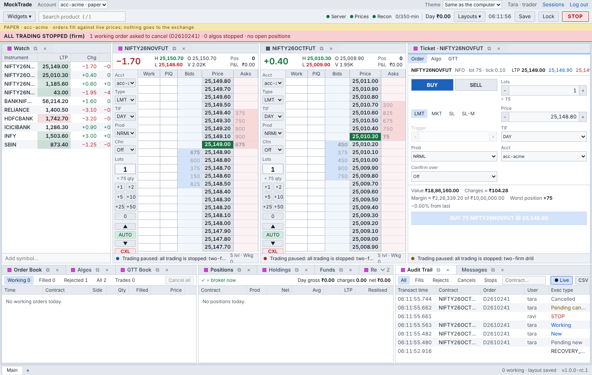

# Several firms on one MockTrade (#368)

Ayush decided on 23 Oct 2026 (#278) that MockTrade will be offered to other firms:
- each trader brings their own Zerodha subscription;
- each trader sees only prices from their own subscription;
- orders go out through one shared IP or each account's own (#372).

This page is the design, written before the code. The work is split into the steps in §8.

## 1. Today

One server is one firm:
- **Admin and risk** see every account, by design.
- **STOP:** one firm-wide kill switch.
- **Prices:** one market-data service carries prices for everyone, from the first Kite account
  that logs in (`broker/kite/live.py`: "the first live account … carries PRICES"). That is
  right for one firm. For several it would show one person's subscription to everyone.
- **Shared datasets:** recorded ticks, imported candles and backtests have one folder each.

## 2. The words

| Word | Meaning |
| --- | --- |
| **Workspace** | one firm (or one person using MockTrade alone). Every user and every broker account belongs to exactly one, for life. |
| **Workspace admin** | today's `admin` role, inside its own workspace only: users, accounts, limits, STOP and resume for that workspace. |
| **Platform operator** | whoever runs the server. **Not a role on the screens at all.** They act only from the server's terminal (the `users` tool): create a workspace and its first admin, rotate keys, revoke sessions, back up. No web request can ever act as the operator, so no workspace admin can become one. |
| **Price source** | one broker connection that carries prices: one Kite account's ticker under its own subscription, or the simulator / a replay (MockTrade's own data, shareable). |

## 3. The rule

Every request, stream message, file, job and cache answers one question first: **is this
thing in the asker's workspace?**
- The asker's workspace comes from their verified login (the session's user), never from
  anything they send.
- Something in another workspace is answered exactly like something that doesn't exist
  (404, "no such account"). An id tried from outside learns nothing.
- Inside a workspace, today's rules apply unchanged: trader, risk, admin; owner and
  delegated traders; turned-off accounts (#270, #366).

| Thing | Belongs to | How it is scoped |
| --- | --- | --- |
| user, session | the user's workspace | `users.workspace` |
| broker account; its orders, positions, fills, algos, GTTs, charges, MTM, reports, audit | the account's workspace | `accounts.workspace`; every account route first checks it |
| admin and risk screens | the asker's workspace | lists filtered; ids from elsewhere: 404 |
| STOP / resume of "the firm" | the workspace | one kill switch per workspace, not one per server |
| alert bands | an account's: its viewers. A workspace's (its prices): that workspace. The server's (disk, audit log): everyone, in words that name no other firm | `Alert.workspace` |
| market alerts, webhooks, settings, layouts, sessions | the user | already per user |
| backtests | the user who ran them; the workspace admin sees their workspace's | `owner` + workspace |
| recorded ticks, imported candles | the price source they came from | a folder per source |
| the audit trail | one file; every row names its account or workspace | exports filtered |

## 4. Prices: each trader's own subscription

- **One price source per Kite account.** Each account's ticker carries prices into its own
  market-data service. Nothing is shared across accounts.
- **What an account's own checks use:** risk checks, paper fills, algos, GTT sweeps, MTM and
  charts for that account all read from its source.
- **What a person's screens show:** prices from the sources of the accounts they may view.
  - Someone with only their own account sees only their own subscription, which is
    Ayush's rule.
  - **Open question for Zerodha (in the email):** may a risk user or a delegated trader in
    the same firm see the prices of an account they supervise? Until Zerodha answers, the
    setting `MOCKTRADE_PRICES_VISIBLE=owner` keeps every trader to their own accounts'
    sources. `viewers` is the other value.
- **Paper accounts** name the source they fill against: their owner's Kite account. The
  demo and replays use the simulator, our own data, shared freely.
- **Recordings** are kept per source, so one firm's recorded day is never another's.

## 5. What can't leak, and the tests that prove it

The negative tests use two workspaces, each with an admin, a risk user, two traders, accounts,
orders, algos, GTTs, alerts, backtests and recordings.

- **Every REST route** is called by workspace B with workspace A's ids. The route list is read
  from the app, so a new route is covered automatically. The answer is never a 2xx and never
  holds A's data.
- **The stream:** B's screens never receive A's orders, positions, alerts, ticks or bands.
- **STOP:** B's firm STOP never touches A.
- **Exports and files:** reports, audit export, backtests, recordings, candles.
- **Jobs:** square-off, end-of-day reports and the daily login act per account. A's job never
  writes into B's folders.
- **Caches:** the option chain and charts are keyed by price source.
- **The admin screen:** B's admin can't list, change or reset A's users or accounts, and
  can't grant itself a role that reaches A. No role reaches the operator.

## 6. Moving today's data

The existing data becomes the workspace `main`:
- every user and account is moved into it;
- today's admins become `main`'s workspace admins;
- nothing changes for them.

A new firm is created with
`users add-workspace <id> <name> --admin <user>`, from the server only.

## 7. What this does not do

- **Separate servers or databases per firm:** one server, one set of files, separated by the
  rule above. A firm that needs its own server runs its own.
- **Billing.**
- **A Zerodha platform agreement:** that is Ayush's email, and nothing goes live for an
  outside firm before Zerodha's answer.

## 8. Steps

**Progress:**
- **368a (#394), done:** its route sweep tries all 115 routes from another firm
  (`tests/test_workspaces.py`).
- **368b (#395), first half:** done in the PR "each account trades on its own prices".
  - Each Kite account's ticker feeds only its own prices (`marketdata/sources.py`).
  - Each account's risk checks, positions, algos, GTTs, MTM, recovery and expiry settlement
    read them.
  - A paper account fills on its owner's own Kite prices, and is refused without one.
  - Each screen's live prices are its owner's own subscription's.
- **368b, second half, done:** each source has its own market (`marketdata/markets.py`), so the
  screens read the asker's own subscription:
  - the chart (candles from its own ticks, history through its own login);
  - the option chain and strategy builder;
  - time and sales, movers, volume at price and the instrument card's last price;
  - price alerts, checked only on their owner's prices.
- **368c (#396), done:** files and jobs per firm and per subscription
  (`tests/test_firm_files.py`, the operator's runbook [firms.md](../runbooks/firms.md)):
  - recorded ticks in a folder per Kite subscription (`data/ticks/@<account>`);
  - imported candles in a folder per firm (`data/candles/@<firm>`); a firm's admin imports them;
  - a backtest replays its owner's own subscription's days and their firm's candles;
  - end-of-day reports value open positions at the account's own prices;
  - each subscription is checked for silence on its own, with a band for its viewers only.

- **368d (#397), done:** the two-firm drill in a real browser (`context/scripts/drill-two-firms.cjs`; evidence `context/evidence/h-397-two-firm-drill.txt`; screenshots `context/images/h-397-*.png`), 16/16:
  - the operator adds firm acme from the terminal, exactly as the runbook says;
  - each firm sees only its own accounts and users, on the API and on the Admin screen;
  - an acme order is invisible to main, and each firm asking for the other's account is answered "not found";
  - acme's firm STOP shows on acme's screens only and cancels acme's resting order, while main keeps trading;
  - no page errors.

| Step | What | Done when |
| --- | --- | --- |
| **368a** (#394) | Workspaces in the data, the rule in every access check, STOP per workspace, the operator only on the terminal | the two-workspace route sweep and stream tests pass |
| **368b** (#395) | Prices per source (each Kite account its own), what screens may see, paper accounts' source, caches and recordings per source | B never sees a tick from A's subscription; each account's checks use its own source |
| **368c** (#396) | Files and jobs per workspace (backtests, candles, ticks, reports), the operator's `add-workspace`, the admin runbook | the file and job tests pass |
| **368d** (#397) | A two-firm drill on the demo, in the browser | two firms trade side by side; nothing of one appears to the other |
