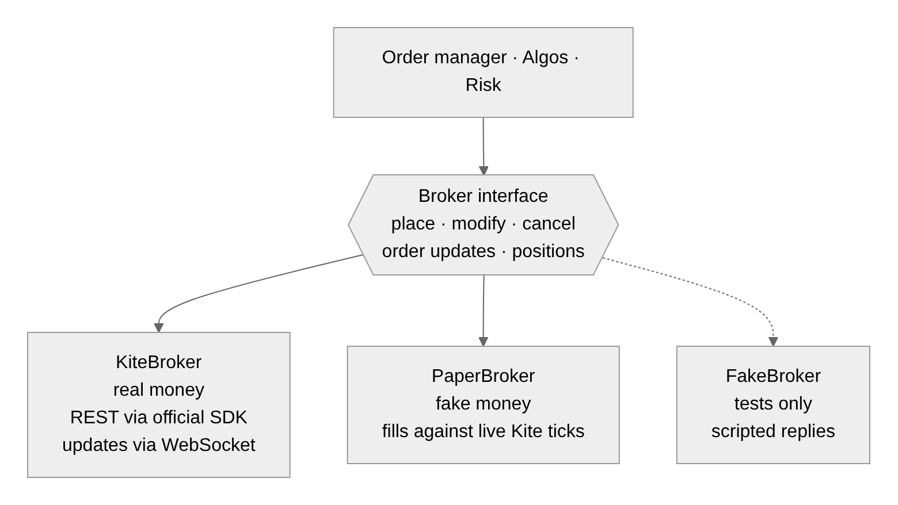
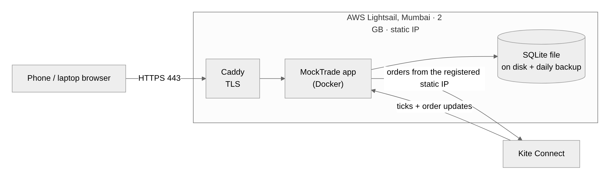

# Chapter 2 · The big picture (architecture)

[Guide home](README.md) · previous: [Chapter 1](01-trading-from-zero.md) · next: [Chapter 3 · One order's journey](03-one-orders-journey.md)

---

## 2.1 MockTrade is a restaurant

The easiest way to see the whole system is as a restaurant.

```
 ┌─────────────────────── THE RESTAURANT (the MockTrade server) ───────────────────────┐
 │                                                                                      │
 │  DINING ROOM            WAITER               KITCHEN MANAGER        SAFETY INSPECTOR │
 │  (the screens in   ◄──► (server/app.py:  ──► (orders/manager.py:  ──► (risk/: checks │
 │   your browser)         takes orders,        tracks every order      every order    │
 │                         brings news)         from start to end)      before it goes)│
 │                                                    │                                 │
 │                                                    ▼                                 │
 │  NOTICE BOARD            LEDGER                 THE SUPPLIER'S PHONE                 │
 │  (marketdata/: the  ──►  (store/events.py:      (broker/: Zerodha Kite,              │
 │   latest prices,         every event written     or the paper broker)                │
 │   pinned for all)        down, forever)                                              │
 │                                                                                      │
 │  ACCOUNTANT (positions/: what you hold, profit and loss)                             │
 │  ROBOT HELPERS (algos/: send orders for you, by rules)                               │
 │  ALARM SYSTEM (ops/: warnings on every screen)                                       │
 └──────────────────────────────────────────────────────────────────────────────────────┘
```

| In the restaurant | In MockTrade | Folder |
| --- | --- | --- |
| Dining room | The screens (React) | `ui/src/` |
| Waiter | The web API and the live stream | `src/mocktrade/server/` |
| Kitchen manager | The order manager | `src/mocktrade/orders/` |
| Safety inspector | Risk checks, STOP, limits | `src/mocktrade/risk/` |
| The supplier's phone | The broker: Kite, or paper | `src/mocktrade/broker/` |
| Notice board | Live prices | `src/mocktrade/marketdata/` |
| Accountant | Positions and P&L | `src/mocktrade/positions/` |
| Ledger | The audit trail (`events.db`) | `src/mocktrade/store/` |
| Robot helpers | Algos | `src/mocktrade/algos/` |
| Alarm system | Operational alerts, the bands | `src/mocktrade/ops/` |
| The building plan | Wires everything together | `src/mocktrade/platform.py` |

## 2.2 The same thing as a real diagram


And everything on one page:


## 2.3 Two separate programs that talk

```
 ┌───────────────────────────┐          ┌──────────────────────────────────┐
 │ SCREENS (your browser)     │          │ SERVER (one Python program)       │
 │ TypeScript + React         │  ◄────►  │ Python 3.13 + FastAPI             │
 │ ui/src/                    │  REST +  │ src/mocktrade/                    │
 │ only SHOWS things          │  stream  │ DECIDES everything                │
 └───────────────────────────┘          └──────────────────────────────────┘
```

**The golden rule: "the backend provides, the frontend displays".**
- **The server decides** what is allowed (lot sizes, which order types, cut-off times,
  why something was refused), and **publishes** it.
- **The screens just show it.** They never contain a market rule of their own.
- **Why:** rules change (SEBI, the broker, the exchange). If a rule lives in one place, you
  change it in one place.

## 2.4 Every part can be swapped (the "plug" idea)

Each big part is like an appliance with a standard plug. MockTrade only knows the plug shape,
not the appliance behind it.

```
                     the plug: broker/base.py  (place, modify, cancel, updates, orders…)
                                   │
            ┌──────────────────────┼──────────────────────┐
            ▼                      ▼                      ▼
     broker/paper.py         broker/kite/           broker/fake.py
     pretend fills           the real Zerodha       for tests: does exactly
     against live prices                            what the test scripts
```

So to trade for real instead of on paper, MockTrade changes one object. The order manager, risk
checks and screens don't change at all. The same idea applies to prices (live Kite or the
simulator), charges, and storage.



## 2.5 Where it runs

```
 your browser ──https──► a small server in Mumbai (Amazon Lightsail, fixed IP address)
                              │  Caddy (the front door: https, certificates)
                              │  MockTrade (one Docker container)
                              │  /data (the database files, backups)
                              ▼
                         Zerodha Kite (orders must come from a fixed IP: a SEBI rule)
```



- **Docker** is a sealed box that contains the program and everything it needs, so it runs the
  same everywhere.
- **The fixed IP** matters because SEBI (India's market regulator) requires orders from programs
  to come from a registered, fixed address.

## 2.6 One account = one set of everything

`platform.py` builds a complete "kitchen" for each trading account. Every account gets its own
order manager, risk checks, position book, algos and so on, so accounts can never mix.

```
 Platform
  ├── account "acc-paper"   → broker(paper) + order manager + risk + positions + algos + …
  ├── account "acc-ayush"   → broker(kite)  + order manager + risk + positions + algos + …
  ├── shared: prices, the instrument list, the firm-wide STOP switch, the ledger
```

Read `Platform.add_account` in `src/mocktrade/platform.py`: it is the building plan, and it
creates each part in order and connects them.

---

**Check yourself:** point at each box of the restaurant and name its folder. Then go on to
[Chapter 3](03-one-orders-journey.md).
