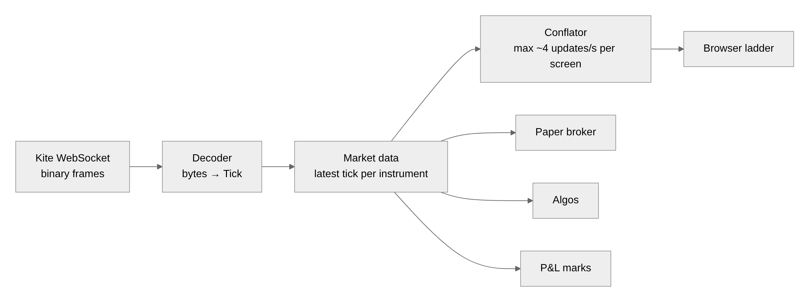
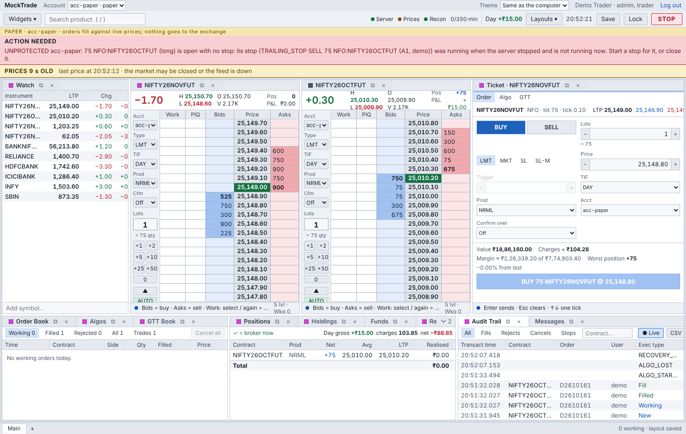
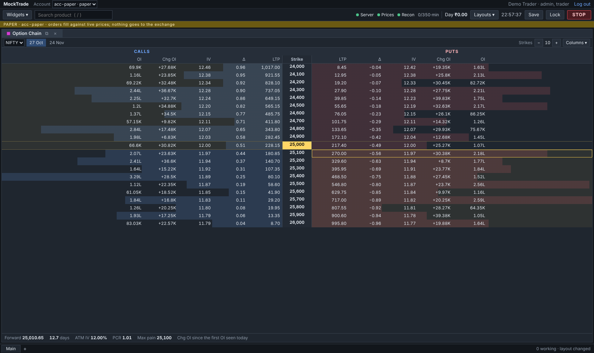

# Chapter 4 · Prices: how the market reaches your screen

[Guide home](README.md) · previous: [Chapter 3](03-one-orders-journey.md) · next: [Chapter 5 · Safety](05-safety.md)

---

## 4.1 A tick is one photo of the market

Many times a second, Kite sends a **tick** for each instrument we watch: a photo of that moment.

```
 TICK  NIFTY26OCTFUT
   last price   ₹25,010.00      (the last trade)
   best buyers  ₹25,009.90 × 300 · ₹25,009.85 × 150 · …    ("bids": who wants to buy)
   best sellers ₹25,010.10 × 225 · ₹25,010.15 × 600 · …    ("asks": who wants to sell)
   volume today 1,24,500
```

The list of best buyers and sellers is the **depth** (or "order book"). The **ladder** widget
draws exactly this: buyers on one side, sellers on the other, prices down the middle.


## 4.2 The path of a price



```
 Kite WebSocket (raw bytes, very compact to save time)
        │
        ▼
 broker/kite/decoder.py      reads the bytes into a Tick
        │                    (like reading a barcode: position 0–4 = the instrument,
        │                     4–8 = the last price, …)
        ▼
 marketdata/service.py       the notice board: keeps the LATEST tick of each instrument
        │                    and tells everyone who subscribed
        │
        ├──► paper broker    "a resting paper order at ₹25,010? the price reached it: fill"
        ├──► algos           a trailing stop follows the price up
        ├──► positions       P&L moves with the price ("mark to market")
        ├──► loss limits     "has this position lost more than its limit?"
        ├──► price alerts    "did NIFTY cross ₹25,100?"
        ├──► candles         1-minute bars for charts
        ├──► recorder        saves ticks to disk (to replay a day later)
        └──► stream          to your screen
```

## 4.3 The demo makes up prices

No Kite in the demo, so `marketdata/simulator.py` invents prices that wiggle like real ones. A
recorded day can also be **replayed** (`research/replay.py`): yesterday's real ticks played back
as if live, which is good for testing ideas.

```
 live:    Kite ──────────────► MarketData
 demo:    simulator ─────────► MarketData     (the rest of Laddrix can't tell the difference)
 replay:  recorded ticks ────► MarketData
```

This is the "plug" idea from [Chapter 2](02-big-picture.md) again.

## 4.4 When prices stop

If no tick arrives for 5 seconds while you watch something, a yellow band says so. The market
may be closed, or the feed may be down.



Orders are never priced on old data (#267): an order that would add risk is refused while its
price is older than the limit, and the screens say why.

## 4.5 Charts and options use the same prices

- **Charts** (`charts/`): ticks are grouped into candles (open, high, low, close for each minute).
- **The option chain** (`options/chain.py`): for each strike, the call and put prices, plus
  the **Greeks**. Greeks are numbers that say how an option's price reacts when the market
  moves, when time passes, or when volatility changes. They come from a formula in
  `options/pricing.py`.



---

Next: [Chapter 5 · Safety](05-safety.md), the most important chapter.
