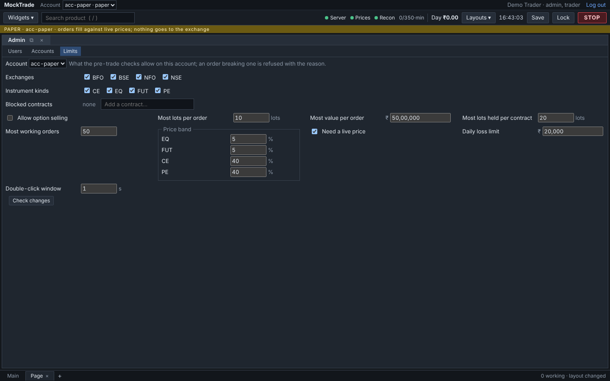
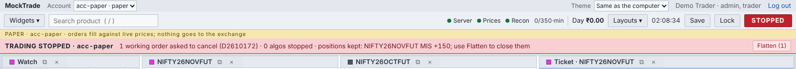
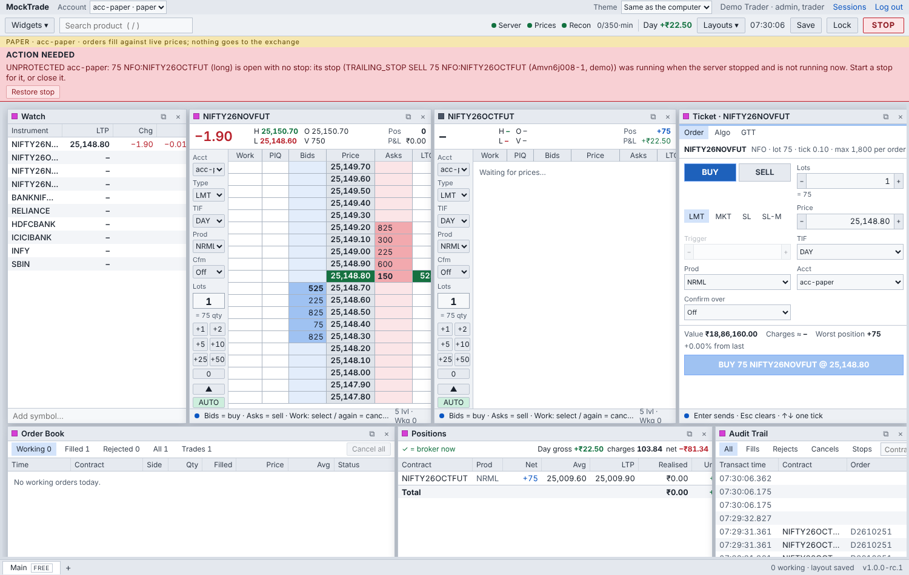

# Chapter 5 · Safety: every guard, and why it exists

[Guide home](README.md) · previous: [Chapter 4](04-prices.md) · next: [Chapter 6 · The screens](06-screens.md)

A car has brakes, seat belts, airbags and a dashboard light for each problem. MockTrade has the
same kinds of things for money. Each one here exists because something really can go wrong, and
each has tests that break it on purpose to prove it works.

---

## 5.1 The seat belts: checks on every order

Every order passes the **gates** before it may leave ([Chapter 3](03-one-orders-journey.md#34-stop--the-safety-inspector-the-gates)).
The limits (the biggest order, the biggest position, the daily loss and so on) are set by an
admin in the Admin screen.



## 5.2 The big red button: STOP

```
 you press STOP (or Ctrl+Shift+K)
        │
        ▼
 ① the switch turns ON FIRST         nothing new can slip in from this moment
        │
        ▼
 ② every working order is cancelled
        │
        ▼
 ③ every algo is stopped
        │
        ▼
 ④ positions STAY OPEN               STOP is a brake, not a reverse gear
        │
        ▼
 the red band says EXACTLY what happened:
 "1 working order asked to cancel (D2610172) · 0 algos stopped ·
  positions kept: NIFTY26NOVFUT MIS +150; use Flatten to close them"   [Flatten (1)]
```



**Why the switch turns on before the cancels:** if the cancels went first, a new order could
arrive in between and get through. On first, then cancel, leaves no gap.

## 5.3 Flatten: closing everything on purpose

STOP doesn't close positions. To close them while trading stays stopped, use **Flatten**
in the red band (two clicks).

```
                 STOP is on: every order is refused …
                                 │
            … EXCEPT one that is BOTH:
            ① sent by the exit desk (MockTrade's own closing service, never a person's order)
            ② reduce-only (it can only make a position smaller, never flip it)
                                 │
                                 ▼
            and it still passes every other check (lot size, price band…)
```

Flatten refuses a position whose size it isn't sure of, for example when MockTrade says +75 and
Zerodha says +150. Closing a guessed amount could open a new position by mistake. It tells you
to close that one in Zerodha's own app.

## 5.4 Reduce-only: two exits must never flip you

```
 you are LONG 150. Two things try to close it at the same moment:
   your stop algo sells 150    +    your loss limit sells 150

 without reduce-only:  −150 −150  →  you are now SHORT 150   ✗  (a new risk you never wanted)
 with reduce-only:     the second is refused:
                       "would close more than is open: 150 open, 150 already being closed"  ✓
```

Every closing order is marked reduce-only: those from loss limits, square-off, Flatten and the
stop algos. The safety inspector adds up what is already being closed before letting another
close through.

## 5.5 The exit desk: one careful way to close

`risk/closing.py`. Every forced close goes through it.

```
 "close NIFTY MIS"
     │
     ▼
 take this position's LOCK          (a second close of the same position waits its turn,
     │                               then sees what is left)
     ▼
 stop the algos on this position    (so a stop can't sell at the same moment)
     ▼
 cancel resting orders that would also close it, and wait up to 3 s
     ▼
 look at the position NOW           (fills in the meantime are already counted)
     ▼
 subtract what other closing orders still own
     ▼
 send closing orders for what's left, marked reduce-only
     ▼
 say what it did: "closing +150: sent MT9; cancelled MT4; stopped algos A1"
```

## 5.6 Loss limits you set yourself (MTM)

In the **MTM Limits** screen you can say: "if this position loses ₹1,000, warn me" or "…close it".
You can also set a limit for the whole account.

```
 loss reaches your limit
     │
     ▼
 written to disk FIRST: "this limit fired today"     (a restart can't fire it twice)
     │
 auto-close? ──no──► ALERTED: a red band and a message, you decide
     │ yes
     ▼
 REQUESTED ──► the exit desk closes ──► WORKING (orders out)
                                          │
        ┌─────────────────────────────────┼─────────────────────────────────┐
        ▼                                 ▼                                 ▼
  closed, and Zerodha             still open, nothing working      an unanswered order, or
  agrees on the size              (refused, failed, restart)       Zerodha disagrees on size
        ▼                                 ▼                                 ▼
    COMPLETED ✓                      BLOCKED                          UNKNOWN
                              red band + [Retry] (two clicks)   red band: check Zerodha;
                              never retried by itself           never retried while unknown
```

**Why "never retried by itself":** if a close was refused once, retrying in a loop might keep
failing, or worse. A person reads the reason and decides.

## 5.7 The daily loss limit

```
 today's P&L ≤ −(the daily limit)
     │
     ▼
 STOP turns on by itself ("auto: daily loss"): orders cancelled, algos stopped
     │
     ▼
 only closing trades are allowed after this; Flatten works without resuming
```

## 5.8 Square-off: before the broker does it for you

```
 15:00 ──────────── 15:20 (shares) ── 15:25 (F&O) ─────► time
   │                       │               │
 a warning every        the broker closes your MIS positions itself,
 minute with the        at its price, plus a fee
 minutes left
   │
 [Square off MIS (2)] → [Confirm] → the exit desk closes each one (NRML positions stay)
```

The cut-off times are **data** published by the server, not written into the screens, because
brokers change them.

## 5.9 "Did my order go through?" Unanswered orders

```
 order sent ──► … silence (the network dropped, a timeout)
                    │
                    ▼
       UNCONFIRMED: maybe it reached the exchange, maybe not.
       Its risk still counts. NEVER sent again blindly (that could double it).
                    │
       ask Zerodha for its order list: after 2 s, 5 s, 10 s … (~3 minutes)
                    │
        ┌───────────┴────────────────┐
        ▼                            ▼
   it's in the list            missing from 3 lists, over at least 60 s
   → settled (one order)       → REJECTED, with the check times as proof
        │
 still unclear after all that? → a message: look in Zerodha's own order book,
                                 then press "Not placed?" (two clicks)
```

**Changes and cancels can go unanswered too.** A change with no answer counts the **larger**
size until it's clear (the safe guess). A cancel with no answer stays "on its way" and can be
pressed again.

## 5.10 Reconcile: do MockTrade and Zerodha agree?

```
 on a timer:  MockTrade's positions  vs  Zerodha's positions
                        │
                same? ──yes──► nothing to show
                        │ no
                check again soon (a fill may just be on its way)
                        │
                still different? ──► a band: "MockTrade +75, broker +150 (a missed fill,
                                      or a trade made outside MockTrade)"
```

## 5.11 After a restart: nothing trades until the books are rebuilt

```
 server starts → trading SHUT for each account (recovery.py)
     ▼
 rebuild every order from the ledger (events.db)
     ▼
 ask Zerodha: what are your orders and positions now?
     ▼
 catch up on what happened while we were down
     ▼
 positions agree? ──no──► a band, check before trading that one
     ▼ yes
 trading OPEN
```

## 5.12 Lost stops: UNPROTECTED

A stop algo (trailing stop, OCO, bracket) runs **inside MockTrade**. If MockTrade stops (a crash,
a restart), that stop stops too, and nothing at the exchange stands in for it.

```
 a stop algo protects NIFTY +75 ──► the server restarts (or you pause it, or it fails)
                                         │
                       position still open, and nothing else covers it?
                                         │ yes
                                         ▼
 "UNPROTECTED acc: 75 NIFTY (long) is open with no stop … Start a stop for it, or close it."
```



**The rule to remember:** for a stop that must survive anything, use a **stop-loss order or a GTT
held by Zerodha**, not a MockTrade algo. Making this flag survive every restart, and a safe
"Restore stop" button, is issue #264 (half done; continues Wednesday).

## 5.13 The whole safety net on one page

```
                         ┌──────────── before an order leaves ────────────┐
                         │  gates: limits, price band, lot, margin, 8/s    │
                         │  reduce-only: never close more than is open     │
                         └─────────────────────────────────────────────────┘
 ┌─── when things go wrong ───┐   ┌──── closing safely ────┐   ┌──── after a crash ────┐
 │ STOP (manual or daily loss)│   │ the exit desk          │   │ recovery: shut until   │
 │ unanswered → UNCONFIRMED   │   │ Flatten (even STOPPED) │   │ rebuilt                │
 │ reconcile mismatch band    │   │ MTM limits + Retry     │   │ lost stops flagged     │
 │ prices-old band            │   │ square-off             │   │ backups + restore      │
 └────────────────────────────┘   └────────────────────────┘   └────────────────────────┘
```

---

**Try it** in the demo: press STOP, then Flatten. Set an MTM limit of ₹1 with auto-close and
watch it close. Then go on to [Chapter 6](06-screens.md).
