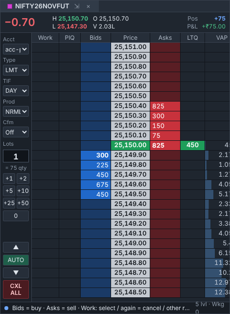
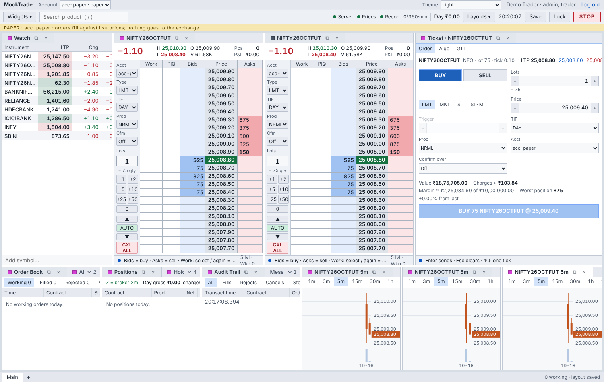
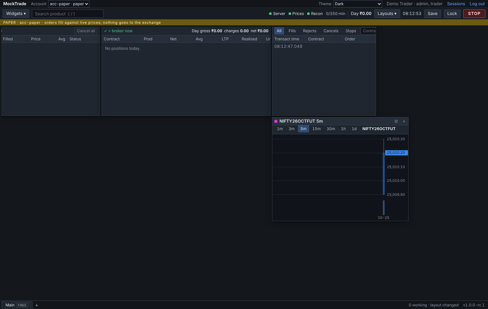
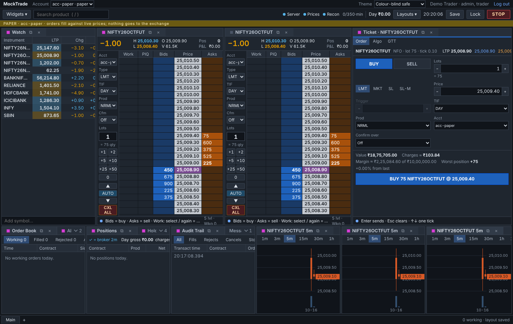

# Chapter 6 · The screens

[Guide home](README.md) · previous: [Chapter 5](05-safety.md) · next: [Chapter 7 · The code, folder by folder](07-code-map.md)

---

## 6.1 The layout: a desk you arrange yourself

```
 ┌───────────────────────────────────────────────────────────────────────────────┐
 │ Laddrix   Account [acc-paper ▾]                       Theme · you · Log out │ ← top
 │ [Widgets ▾] [Search /]     ● Server ● Prices ● Recon   Day ₹0  10:14  [STOP]  │ ← toolbar
 │ ▓▓ red/yellow bands: only when something needs you (STOP, alerts, old prices) │ ← bands
 ├──────────────┬────────────────────┬──────────────────┬────────────────────────┤
 │ Watch        │ Ladder NIFTY       │ Chart            │ Ticket                 │ ← widgets:
 │              │                    │                  │                        │   drag, dock,
 ├──────────────┴────────────────────┴──────────────────┴────────────────────────┤   tab, pop out
 │ Orders · Positions · Audit · Messages                                          │
 └───────────────────────────────────────────────────────────────────────────────┘
```

- **Widgets** are the small windows: each does one job.
- **The workspace** (`ui/src/workspace/`) lets you drag them, stack them in tabs, save layouts,
  and pop them out into their own windows (handy with two monitors).
- **Link colours:** widgets with the same colour follow each other. Click RELIANCE in a pink
  watchlist, and the pink ladder, chart and ticket all switch to RELIANCE.



## 6.2 The widgets, one by one

| Widget | What it's for | Folder |
| --- | --- | --- |
| **Watch** | A list of instruments with live prices. | `widgets/Watch.tsx` |
| **Ladder** | Buyers and sellers at each price; click to trade fast. | `widgets/ladder/` |
| **Ticket** | A form to place one careful order. | `widgets/ticket/` |
| **Orders, Positions, Audit, Messages** | What you sent, what you hold, the full history of an order, and notes from the server. | `widgets/books/` |
| **Chart** | Candles with your orders drawn on them. | `widgets/chart/` |
| **Option chain** | Calls and puts at each strike, with Greeks. | `widgets/chain/` |
| **Strategy** | Multi-leg option strategies (a straddle, for example), with a payoff picture. | `widgets/strategy/` |
| **Algos** | Start, pause and stop robot helpers; see what each is doing. | `widgets/algos/` |
| **GTT** | Triggers held at Zerodha ("when the price hits X, place this"). | `widgets/gtt/` |
| **MTM Limits** | Your own loss limits, and what each did today. | `widgets/mtm/` |
| **Alerts** | Price alerts and webhooks. | `widgets/alerts/` |
| **Market** | Movers, time and sales, depth. | `widgets/market/` |
| **Portfolio** | Funds, holdings, tradebook. | `widgets/portfolio/` |
| **Reports** | The day's reports (CSV, PDF). | `widgets/reports/` |
| **Research** | Recorded days, replay, backtests. | `widgets/research/` |
| **Admin** | Users, accounts, limits (admins only). | `widgets/admin/` |
| **Keys** | Your keyboard shortcuts. | `widgets/keys/` |

**The ticket:**


**Algos:**


**Strategy builder:**


**Admin: users:**


## 6.3 How a widget gets its data

```
 server ──stream──► api/stream.ts ──► state/store.ts ───┬──► Ladder (reads prices)
                     keeps the line     the ONE box      ├──► Order book (reads orders)
                     open; reconnects   that holds       └──► Positions (reads positions)
                     if it drops        everything
                                                         each widget reads only its part,
                                                         and redraws when that part changes
 you click ──► api/rest.ts ──► server ──► the answer arrives back through the stream
```

**Why one box (the store)?** Many widgets show the same order. With one box they always agree.
With a copy in each widget, they could disagree.

## 6.4 The server tells the screens what's possible

When you open the ticket for NIFTY, the screen asks the server for its **order spec**: the
allowed order types, the lot size, the tick, which fields each type needs. The ticket builds
itself from that answer, so a new order type or rule needs no screen change.

```
 ticket opens ──► GET order spec for NIFTY ──► "LIMIT needs price; SL needs price + trigger;
                                                lot 75; tick 0.05; products MIS, NRML"
                                                │
                                                ▼
                                      the form shows exactly those fields
```

## 6.5 Themes and colours

Light, dark, and colour-blind safe. Green and red aren't the only signal: numbers carry
signs and words too, so nobody depends on telling red from green.

| Light | Dark | Colour-blind safe |
| --- | --- | --- |
|  |  |  |

## 6.6 The desktop app

`ui/desktop/` wraps the same screens in a desktop window (Electron), with real pop-out windows.
It's the same code, just a different frame.

---

Next: [Chapter 7 · The code, folder by folder](07-code-map.md).
