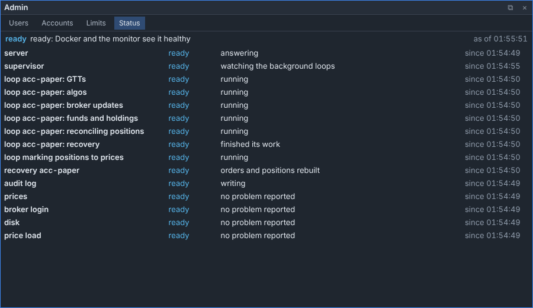
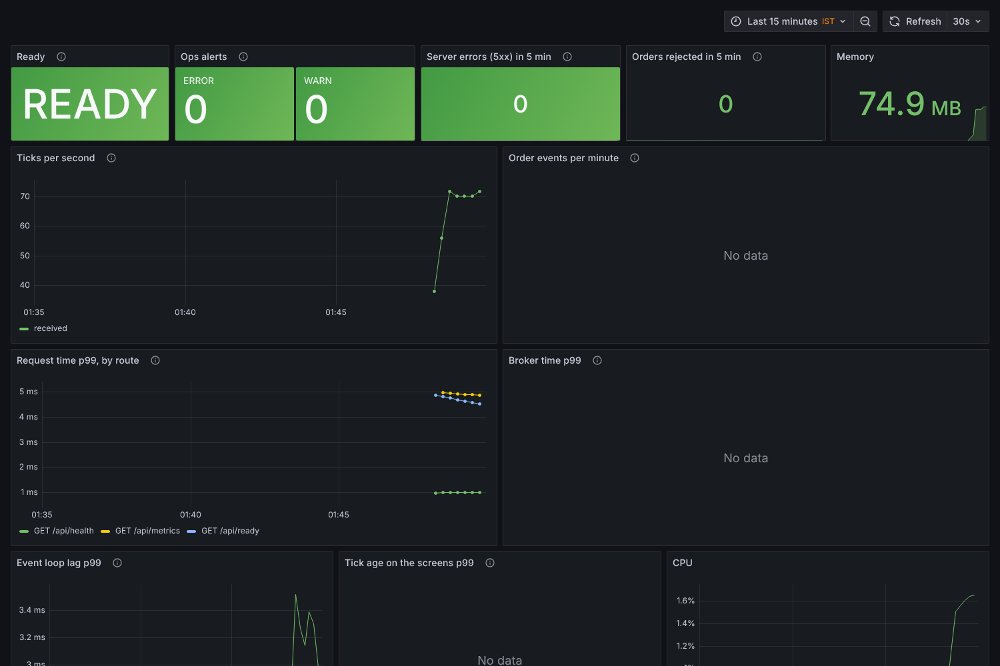

# Monitoring: logs, status, readiness and the dashboard (#287)

Four ways to see how the server is doing. They answer different questions:

| Question | Where | Who |
|---|---|---|
| Is the process alive? | `GET /api/health` (Caddy asks it) | anyone, no login |
| Can it trade? | `GET /api/ready`: 200, or 503 with how many parts are in the way (Docker's health check, the deploy script) | anyone, no login |
| Which part is wrong, why, since when? | the **Status** tab of the **Admin** screen (`GET /api/status`) | admin and risk |
| What happened to this order or request? | the server log (JSON lines) | the operator, on the server |
| How fast, how busy, over the day? | the Grafana dashboard (Prometheus reads `GET /api/metrics`) | the operator, through an SSH tunnel |

```
the server ─┬─ ops/status.py: each part ─┬─► /api/ready  ─► Docker: healthy / unhealthy
            │  ready·starting·degraded·down └─► /api/status ─► the Status tab
            ├─ ops/logs.py: JSON lines ──────► docker compose logs ─► jq
            └─ metrics.py ─► /api/metrics?format=prometheus ─► Prometheus ─► Grafana
```

## Alive and ready are different

- **Alive** (`/api/health`): the web server answers. Caddy keeps checking this one, so the
  screens stay reachable even when the server can't trade. You need them to log in to Kite,
  read the alerts and close positions.
- **Ready** (`/api/ready`): no part is **starting** or **down**. Docker's health check uses this
  one, so `docker compose ps` shows `healthy` only when the server can trade, and the deploy
  script rolls back a release that never gets ready. Caddy starts once the app has started,
  not once it is healthy. A server that is up but not ready must still show its screens.

What each part's state means (`src/laddrix/ops/status.py`):

| State | Meaning | Ready? |
|---|---|---|
| ready | working | yes |
| starting | not working yet, as expected: recovery after a restart, a loop starting | no |
| degraded | working, with a problem to look at: an alert (a Kite login, one firm's own price feed, a lost stop, low disk) | yes |
| down | not doing its job: a critical loop restarting or stopped, the watchdog stuck, a failed recovery, the audit log unable to write, the server's own prices silent in market hours, the disk almost full | no |

A missing Kite login is only **degraded**, never down, on purpose. In the morning the server must
stay "ready enough" for someone to open the screens and log in.

## The status page

**Admin → Status.** One row a part, refreshed every 10 seconds:



- The header shows the worst state, and whether Docker sees the server as healthy.
- A firm's admin sees only their own firm's accounts. On a shared server, the header says
  how many of another firm's parts are not ready, never which ones.
- "since" is when the part entered its state. The server looks at every part every 5 seconds,
  so the time is right to within 5 seconds.

## The log

The server writes one JSON object a line (`LADDRIX_LOG_FORMAT=json`, the default; `text`
gives plain lines):

```json
{"ts":"2026-10-24T09:15:02.113Z","level":"WARNING","logger":"laddrix.orders.manager",
 "msg":"place MT12: no clear answer: TimeoutError()","request_id":"a1b2c3d4e5f60718",
 "user":"ayush","account_id":"acc-ayush","client_order_id":"MT12"}
```

- **`request_id`**: every answer carries it in its `X-Request-ID` header (the browser's
  developer tools show it). A caller may send its own, if it is short and plain.
- **`user`**: who was signed in, once their session was checked.
- **`account_id`, `client_order_id`, `broker_order_id`**: set while an order is placed, changed or
  cancelled, or while a broker update is applied to it.
- The web server's access lines also carry `method`, `path` and `status`.
- Every line passes the secret filter first (`logsafe.py`, #367).

Searching (install `jq` on the server: `sudo apt install jq`):

```bash
logs() { docker compose -f deploy/compose.yaml logs --no-log-prefix --since "${1:-1h}" app; }

logs 2h | jq -c 'select(.client_order_id == "MT12")'          # one order's journey
logs    | jq -c 'select(.request_id == "a1b2c3d4e5f60718")'   # one request, from a report
logs    | jq -c 'select(.level == "ERROR" or .level == "WARNING")'
logs    | jq -c 'select(.status >= 500)'                       # answers that failed
logs 1d | jq -c 'select(.account_id == "acc-ayush" and .level != "INFO")'
```

The audit trail stays the record of what happened to orders (the Audit Trail screen, or
`python -m laddrix.tools.audit`). The log is for finding problems.

Docker keeps 5 files of 10 MB for each container (`deploy/compose.yaml`). Save what you need
before it rotates: `logs 1d > incident-$(date +%F).jsonl`. A central log store only becomes
worth it if the server is ever split into several processes.

## The dashboard (optional)

Prometheus reads the app's metrics every 15 seconds; Grafana draws them:



It shows readiness, active alerts, 5xx answers, rejected orders, memory, ticks a second, order
events a minute, p99 request time by route, p99 broker time, event loop lag, tick age and CPU.
The definition is `deploy/monitoring/grafana/dashboards/laddrix.json`.

**Turning it on:**

1. In `deploy/.env`, set Prometheus's own key and Grafana's admin password:
   ```bash
   echo "LADDRIX_METRICS_TOKEN=$(openssl rand -hex 32)" >> deploy/.env
   echo "GRAFANA_ADMIN_PASSWORD=<a long password>" >> deploy/.env
   ```
2. Restart the app (it reads the key at start), then start the two monitoring containers:
   ```bash
   docker compose -f deploy/compose.yaml up -d app
   docker compose -f deploy/compose.yaml --profile monitoring up -d
   ```
3. Grafana listens on the server only (`127.0.0.1:3000`). From your computer:
   ```bash
   ssh -L 3000:127.0.0.1:3000 <you>@<server>
   ```
   Then open <http://localhost:3000> and log in as `admin`. The Laddrix dashboard is the home page.

**Checks:**
- Prometheus reads the app:
  `docker compose -f deploy/compose.yaml exec prometheus wget -qO- localhost:9090/api/v1/targets`
  shows the `laddrix` target with `"health":"up"`.
- The key is the only way in without a login. It reads the Prometheus text and nothing else.
  A wrong or missing key gets 401. With no key set, only signed-in admin and risk users can
  read `/api/metrics`.

Prometheus keeps 30 days (`--storage.tsdb.retention.time`). Nothing in it identifies a person:
metric names carry route templates, never ids.

## When something is red

| You see | Look at |
|---|---|
| Ready is red / `docker compose ps` says unhealthy | the Status tab: the row that is starting or down, and its reason |
| A loop down | [incidents.md](incidents.md#-is-restarting-or--keeps-failing-273) |
| Prices down | [incidents.md](incidents.md#websocket-down) |
| The audit log down | [incidents.md](incidents.md#the-audit-log-cant-write-265) |
| Recovery starting or down | [incidents.md](incidents.md#trading-paused-after-a-restart) |
| 5xx answers | `logs \| jq -c 'select(.status >= 500)'`, then that `request_id`'s lines |
| Orders rejected | the Audit Trail screen says why for each |
